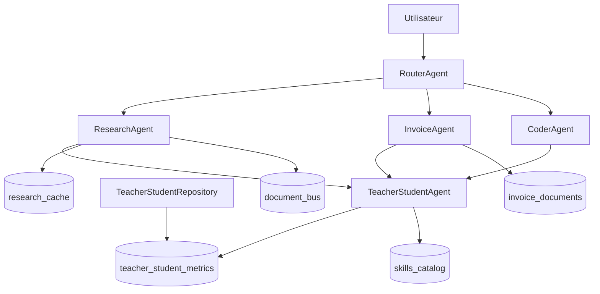

RouterAgent

├── ResearchAgent
├── InvoiceAgent
├── MemoryAgent
└── TeacherStudentAgent

Qdrant

├── document_bus
├── skills_catalog
├── research_cache
├── invoice_documents
├── teacher_student_metrics
└── mem0_memories
MemoryAgent V1

Mission :
Entrée
     ↓

Classifier

     ↓

Facture ?
→ invoice_documents

Document ?
→ document_bus

Recherche ?
→ research_cache

Skill ?
→ skills_catalog

Souvenir ?
→ mem0_memories

V6 doit devenir :
ResearchAgent
       ↓
MemoryAgent

InvoiceAgent
       ↓
MemoryAgent

TeacherStudentAgent
       ↓
MemoryAgent
`
MemoryAgent
↓
Qdrant
APRÈS MEMORY AGENT
RouterAgent V6
qui deviendra le point d'entrée unique :
Cherry

OpenWebUI

AnythingLLM

n8n

API
RouterAgent
Research
Invoice
Memory
TeacherStudent

RouterAgent

├── ResearchAgent
├── InvoiceAgent
├── CoderAgent
└── TeacherStudentAgent

ResearchAgent
↓
TeacherStudentAgent

InvoiceAgent
↓
TeacherStudentAgent

# DSH-Core Architecture V6

## Objectif

DSH-Core V6 est une architecture multi-agents reposant sur :

- Ollama (LLM locaux)
- Qdrant (mémoire vectorielle)
- LangGraph (orchestration)
- Langfuse (observabilité)
- TeacherStudent (apprentissage continu)

L'objectif est d'augmenter progressivement l'autonomie du système et de mesurer les performances réelles de chaque agent.

---

# Vue d'ensemble



---

# Agents

## RouterAgent

Responsabilités :

- analyser l'intention utilisateur
- sélectionner l'agent approprié
- transmettre la requête

Sorties :

- ResearchAgent
- InvoiceAgent
- CoderAgent

---

## ResearchAgent

Responsabilités :

- recherche web
- recherche documentaire
- synthèse LLM
- cache sémantique

Collections utilisées :

- research_cache
- document_bus

Modes :

- QUICK
- DEEP
- DOCUMENT
- TOR

Flux :

```text
Question
↓
Router
↓
ResearchAgent
↓
DDGS / Playwright
↓
TeacherStudent
↓
Qdrant
```

---

## InvoiceAgent

Responsabilités :

- OCR
- Structuration
- Validation comptable
- Réparation OCR
- Archivage

Collection :

- invoice_documents

Flux :

```text
Facture
↓
OCR
↓
Vision
↓
Structuration
↓
Validation
↓
TeacherStudent
↓
Qdr

DSH-Core Architecture V6
Objectif
DSH-Core V6 est une architecture multi-agents reposant sur :

Ollama (LLM locaux)
Qdrant (mémoire vectorielle)
LangGraph (orchestration)
Langfuse (observabilité)
TeacherStudent (apprentissage continu)
L'objectif est d'augmenter progressivement l'autonomie du système et de mesurer les performances réelles de chaque agent.

Vue d'ensemble
flowchart TD

    USER[Utilisateur]

    ROUTER[RouterAgent]

    RESEARCH[ResearchAgent]
    INVOICE[InvoiceAgent]
    CODER[CoderAgent]

    TS[TeacherStudentAgent]

    KPI[TeacherStudentRepository]

    QBUS[(document_bus)]
    QCACHE[(research_cache)]
    QINV[(invoice_documents)]
    QSKILL[(skills_catalog)]
    QMETRIC[(teacher_student_metrics)]

    USER --> ROUTER

    ROUTER --> RESEARCH
    ROUTER --> INVOICE
    ROUTER --> CODER

    RESEARCH --> TS
    INVOICE --> TS
    CODER --> TS

    RESEARCH --> QCACHE
    RESEARCH --> QBUS

    INVOICE --> QINV

    TS --> QMETRIC
    TS --> QSKILL

    KPI --> QMETRIC
Agents
RouterAgent
Responsabilités :

analyser l'intention utilisateur
sélectionner l'agent approprié
transmettre la requête
Sorties :

ResearchAgent
InvoiceAgent
CoderAgent
ResearchAgent
Responsabilités :

recherche web
recherche documentaire
synthèse LLM
cache sémantique
Collections utilisées :

research_cache
document_bus
Modes :

QUICK
DEEP
DOCUMENT
TOR
Flux :

Question
↓
Router
↓
ResearchAgent
↓
DDGS / Playwright
↓
TeacherStudent
↓
Qdrant
InvoiceAgent
Responsabilités :

OCR
Structuration
Validation comptable
Réparation OCR
Archivage
Collection :

invoice_documents
Flux :

Facture
↓
OCR
↓
Vision
↓
Structuration
↓
Validation
↓
TeacherStudent
↓
Qdrant
↓
n8n
CoderAgent
Responsabilités :

génération de code
correction de code
analyse technique
Intégration TeacherStudent prévue.

TeacherStudentAgent
Responsabilités :

mesurer l'autonomie du système
enregistrer chaque succès ou échec
escalader :
Qwen 9B ↓ Qwen 27B ↓ Claude/OpenRouter ↓ Skill

Collection :

teacher_student_metrics
Future collection :

skills_catalog
Collections Qdrant
document_bus
Rôle :

Base documentaire principale.

Contenu :

PDF
Notes
Documentation
Connaissances métier
Usage :

RAG documentaire.

research_cache
Rôle :

Cache des recherches.

Clé :

UUID5(query)

Usage :

Réduire les appels web inutiles.

invoice_documents
Rôle :

Archivage des factures validées.

Usage :

recherche
audit
reporting
skills_catalog
Rôle :

Bibliothèque des compétences apprises.

Statut :

Préparation V7.

teacher_student_metrics
Rôle :

Historique d'apprentissage.

Contient :

succès 9B
appels expert
appels superviseur
création de skill
réutilisation de skill
TeacherStudentRepository
Responsabilités :

Calcul des KPI globaux.

Exemples :

autonomie du 9B
dépendance Claude
nombre de skills créés
ROI d'apprentissage
Exemple :

repo.get_global_metrics()
Résultat :

{
    "total_workflows_processed": 124,
    "autonomy_9b_success": 96,
    "escalations_to_27b": 18,
    "escalations_to_claude": 10
}
Indicateurs stratégiques
Autonomie 9B
autonomy_9b_success
/
total_workflows_processed
Objectif :

80 %

Dépendance superviseur
escalations_to_claude
/
total_workflows_processed
Objectif :

< 10 %

Apprentissage
skills_created
Objectif :

croissance continue.

Roadmap
V6
✅ ResearchAgent

✅ InvoiceAgent

✅ TeacherStudentAgent

✅ TeacherStudentRepository

✅ Qdrant KPI

V6.5
embeddings réels pour facture
meilleure validation comptable
cache avancé
V7
skills_catalog automatique
création de compétences par Claude
réutilisation automatique
V8
Neo4j
graphe de connaissances
relations Agent → Skill → Document → Facture

V6 ✅

ResearchAgent
InvoiceAgent
TeacherStudentAgent
TeacherStudentRepository

V6.5 ✅

invoice_embedding_service.py
invoice_similarity_service.py
accounting_validator.py

V7 ✅

skills_repository.py
skill_router.py
skill_creator_agent.py

V7.5 ✅

memory_repository.py
memory_manager.py

# Vision

DSH-Core est une plateforme de mémoire d'entreprise augmentée par l'IA.

Le système a pour mission de :

- centraliser les actifs de connaissance
- enrichir leur compréhension
- construire une mémoire sémantique
- construire une mémoire relationnelle
- apprendre à partir de ses erreurs
- réutiliser les compétences acquises

La comptabilité n'est qu'un cas d'usage parmi d'autres.

DSH-Core doit être capable de gérer :

- documents comptables
- catalogues
- tarifs
- documentation technique
- projets web
- contenus marketing
- fiches produits
- ventes Amazon
- connaissances métier
- compétences d'agents

Vision
DSH-Core est une plateforme de mémoire d'entreprise augmentée par l'IA.

Le système a pour mission de :

centraliser les actifs de connaissance
enrichir leur compréhension
construire une mémoire sémantique
construire une mémoire relationnelle
apprendre à partir de ses erreurs
réutiliser les compétences acquises
La comptabilité n'est qu'un cas d'usage parmi d'autres.

DSH-Core doit être capable de gérer :

documents comptables
catalogues
tarifs
documentation technique
projets web
contenus marketing
fiches produits
ventes Amazon
connaissances métier
compétences d'agents

Nouvelle Architecture Globale

Ajouter dans :

Plain Text
docs/architecture_v6.md
Afficher plus de lignes
Niveau 0 : Assets
Plain Text
OneDrive
Disque A:
Afficher plus de lignes

Contient :

Plain Text
PDF
Images
Catalogues
Tarifs
Excel
Sites web
Documentation
Factures
Avoirs
BL
Relevés bancaires
Afficher plus de lignes

C'est la vérité absolue.

Niveau 1 : Registres Métier

Nouveau chapitre.

Plain Text
DocumentLedger
BankingLedger
CatalogLedger
ProjectLedger
Afficher plus de lignes

Ces registres deviennent :

Plain Text
la vérité structurée

Ce que j'ajouterais tout de suite à la documentation

Nouveau schéma :

Plain Text
Assets
↓
Ledgers
↓
Qdrant
↓
Neo4j
↓
Agents
Afficher plus de lignes

avec cette phrase :

Plain Text
Les bases Qdrant et Neo4j doivent toujours pouvoir être reconstruites à partir des Assets et des Ledgers.
 
Les Assets et les Ledgers constituent la source de vérité du système.
Afficher plus de lignes

C'est probablement l'évolution la plus importante de l'architecture depuis le début du projet, parce qu'elle transforme DSH-Core d'un ensemble d'agents IA en véritable système de mémoire d'entreprise extensible.