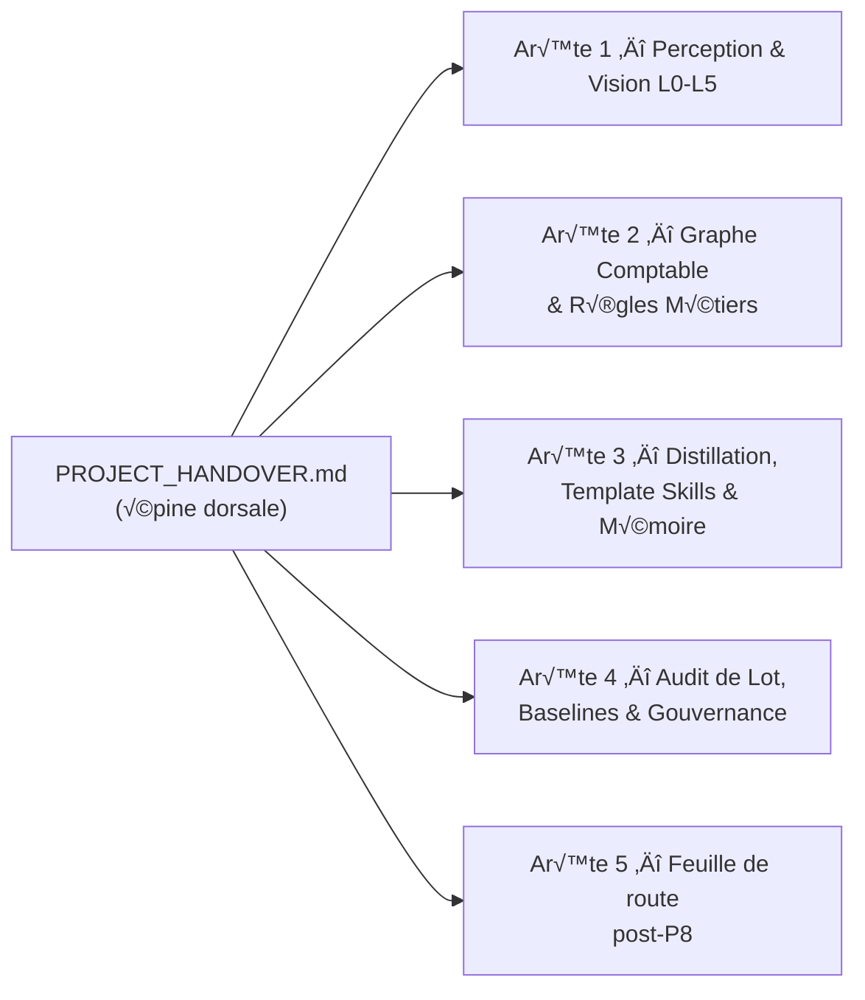

# DSH-Core — PROJECT_HANDOVER (Épine dorsale)

> **RÈGLE DE NAVIGATION** : ce document est le **seul point d'entrée maître** (architecture « arête de poisson » / Hub & Spoke).
> Un humain ou un agent IA qui lit UNIQUEMENT ce fichier doit : (1) connaître l'état exact du projet,
> (2) voir la cartographie complète des documents, (3) savoir QUEL document secondaire lire et pourquoi,
> (4) retrouver les dépendances code/tests de chaque domaine. Toute branche (`docs/*.md`) pointe en
> retour vers ce fichier via son bloc de métadonnées `master_doc`.

---

## 1. ÉTAT DE SANTÉ & LIGNE DE BASE ACTUELLE

| Indicateur | Valeur de référence |
|---|---|
| **Socle Document & Vision Pipeline** | **v1.0.1 — GELÉ DÉFINITIVEMENT** (Phases P0→P8 + P8.1) |
| Contrat | `docs/DOCUMENT_PERCEPTION_CONTRACT.md` v1.0.1 (FROZEN) |
| **Persistance Qdrant / Neo4j** | **v1.0.2 FROZEN** — P9.1→P9.4 et isolation multi-tenant P10.1 |
| Contrat de persistance | `docs/PERSISTENCE_QDRANT_NEO4J_CONTRACT.md` v1.0.2 (FROZEN) |
| **Noyau gelé** | Perception et pipeline facture v1.0.1 ; persistance v1.0.2 — toute évolution = phase + migration + incrément de version |
| **Arête 5** | **v1.0.2 FROZEN** — ontologie Neo4j `Tenant`/`Supplier`/`Invoice`/`InvoiceLine`/`RuleOutcome`, correction E4, payload Qdrant strict `InvoiceVectorPayloadV1` et identifiants isolés par tenant |
| Phases P10→P24 | **Terminées** — isolation multi-tenant, rapprochement bancaire avec arbitrage HITL, exports comptables, persistance SQLite, ingestion bancaire, machine à états OneDrive / Gmail, Vault Obsidian, ingestion automatique `00_INBOX`, watcher de production, exports analytiques, spécialisation métier APD, simulateur de déclaration annuelle TVA CA12, relève Gmail APD et rapprochement bancaire OFX / LCR, tableau mère unifié des pièces comptables, miroir bancaire Caisse d'Épargne, unification APD/default et régime TVA sur encaissements / décaissements réels |
| **Chaîne de production** | **P14 / P15 / P16 / P17 / P18 / P19 / P20 / P21 / P22 : TERMINÉE** — P14.1→P14.5 (machine à états, classeur `_A_COMPLETER.xlsx`, synchronisation bidirectionnelle, ingestion `00_INBOX`, rafraîchissement automatique des exports), P15.1→P15.3 (Vault Obsidian, workflows `instructions.md`, watcher d'arrière-plan), P16.1→P16.2 (synthèses par catégorie, grand livre fournisseur), P17 (profil APD, connecteur mail manuel, 4 sous-catégories de frais, 2 tableaux mères, anti-doublon TVA et bascule d'exercice), P18 (simulateur CA12, comparatif Scénario A / Bascule Janvier-Février, acomptes semestriels et export Excel) et P19 (runner Gmail APD, parseurs OFX Caisse d'Épargne et bordereau LCR, réconciliation 1-vers-N et règles de mode de paiement par tiers) et P20 (filtrage Gmail sécurisé, import de lot clients Sage/PDF, lettrage LCR/virements) ; pont Vault (`services/vault_accounting_bridge.py`) et auto-export (`CategorySummaryExporter` / `SupplierLedgerExporter` / `07-compta/Cockpit_Compta.md`) branchés sur le watcher |
| Suite de tests | **3431 tests passés** hors-ligne (dernière exécution complète avant P23), 2 conditionnés, 0 échec (`.\.venv-v3\Scripts\python.exe -m pytest tests -q`) — baseline 3293 (aafc8bd), +66 tests P19 (`test_p19_ofx_lcr_reconciliation_exhaustive.py` : OFX SGML, bordereau LCR 7 lignes / 9 240,48 €, réconciliation 1-vers-7, règles tiers et CLI `fetch_apd_emails.py --dry-run`) ; +39 tests P20/P21 (`test_p20_customer_batch_and_gmail_filter_exhaustive.py` : filtre Gmail lexical + PDF 5 Ko, 23 factures Sage 34 897,87 € HT, lettrage 91374/91787/92174/94694 et virements SCTI/Yucell) ; P21 (	est_p21_bosch_sia_and_unified_inbox_exhaustive.py : decoupage physique PIECES_JOINTES, Bosch/Sia, Boxtal 65,47 EUR, deballage Outlook rfc822/.eml, 00_INBOX unifie, cockpit) ; P22.2 (+7 tests : miroir OneDrive `ONEDRIVE_INBOX_PATH`, aspiration smartphone, `PermissionError` différée, lanceur Bureau) |
| Batch audit (69 docs) | **Parité 100 %** : 29 VALIDATED / 40 HITL / 0 REJECTED (off == on) |
| Performance perception | 12,4 s / 69 docs = **180 ms/doc** — dérogation validée (off = 1,5 s mais sans perception L1-L5) |
| Fast-path L0 | Actif sur **60/69** docs (0 rasterisation, 1 passe de routage, deskew borné) |
| Baseline signée | `workspace/invoices/audit/baseline.json` (run `p8-1-final2`, git `f10de1e`) |
| Template Skills | `workspace/skills/` : `invoice_smtrt_sas.json` v2, `invoice_edf.json`, `invoice_crisol_color.json` (SUP_0002) |
| Mémoire fournisseurs | `workspace/suppliers/suppliers.json` (SMTRT SUP_0001, CRISOL COLOR SUP_0002 / ESB17443482) |
| Assainissement Qdrant P9.4 | **0 point, 0 non conforme, 0 candidat de purge** — purge effectuée : **0 point legacy restant**, dossier `docker/qdrant_storage` supprimé |
| Neo4j legacy | `services/neo4j_service.py` et `repositories/graph_repository.py` : **NON BRANCHÉS** (aucun appelant raccordé ; hors contrat unifié) |

### Chantiers terminés (faits acquis)
- **P0-P8.1** : contrats `DocumentPerception`/`VisualAnnotation` (L1), géométrie + fast-path (L0), routeur (L2), extracteurs PyMuPDF/Pandas/Docling/PaddleOCR (L3), annotations (L4), moteurs symétriques Local/Cloud/Hybrid + façade `perceive_document` (L5), rebranchement `invoice_graph` + `run_batch_audit`, distillation Template Skills (teacher Gemini), gel contractuel.
- **P9.1-P9.4** : persistance unifiée Qdrant/Neo4j, ontologie `Tenant`/`Supplier`/`Invoice`/`InvoiceLine`/`RuleOutcome`, payload `InvoiceVectorPayloadV1`, correction E4 (suppression de l'écrasement `Product`), tests déterministes hors-ligne et assainissement Qdrant.
- **P10.1** : contrat de persistance v1.0.2 FROZEN ; `invoice_id`, `line_id` et `point_id` sont dérivés de `tenant_id` et `source_sha256` pour prévenir les collisions inter-tenants ; garanties couvertes par `tests/test_multitenant_isolation.py` (61 tests).
- **P10.2** : middleware ASGI pur `TenantContextMiddleware` pour contrôler l'en-tête `X-Tenant-ID`, rejeter précocement les requêtes invalides et exposer le tenant dans le `ContextVar` ; point d'entrée FastAPI `backend/app/main.py` ; couverture exhaustive dans `tests/test_tenant_middleware_exhaustive.py` (39 tests).
- **P10.3** : `RuleRegistryService` charge les règles communes depuis `knowledge/rules/common/` et les règles tenant depuis `knowledge/rules/tenants/{tenant_id}/`, avec protection contre la traversée de répertoire.
- **P11.1** : `POST /reconciliation/arbitrate` arbitre les opérations via `ATTACH_INVOICE`, `PERSONAL_EXPENSE` (comptes 108/455) ou `VALIDATE_WITHOUT_INVOICE`.
- **P11.2** : `ObsidianCandidateRuleWriter` persiste physiquement les règles candidates au format Markdown avec frontmatter YAML.
- **P11.3** : `GET /reconciliation/lines` fournit une consultation paginée avec filtres, recherche plein texte et mapping des statuts.
- **P11.4** : composants React / Next.js de rapprochement : `frontend/types/reconciliation.ts`, `frontend/components/reconciliation/ArbitrationModal.tsx` et `frontend/components/reconciliation/ReconciliationTable.tsx`.
- **P12.1** : moteur officiel FEC A.47 A-1 dans `services/fec_export_service.py`, validation des 18 colonnes et équilibre strict Débit = Crédit ; export via `GET /accounting/export/fec`.
- **P12.2** : moteur CSV de révision comptable et de relevé des arbitrages dans `services/accounting_spreadsheet_export_service.py`, avec neutralisation des injections de formules ; export via `GET /accounting/export/spreadsheet`.
- **P12.3** : barre d'actions d'export dans `frontend/components/reconciliation/ReconciliationTable.tsx`, avec filtres de dates et téléchargement des réponses sous forme de blob.
- **P13.1** : store SQLite multi-tenant hermétique dans `services/sqlite_accounting_store.py`, unifiant les contrats `FecEntryStore` et `ArbitrationStore` (isolation par tenant, transactions et erreurs typées) ; couverture dans `tests/test_sqlite_accounting_store_exhaustive.py`.
- **P13.2** : parseur bancaire multi-formats dans `services/bank_statement_parser_service.py` (formats de dates, montants, devises, délimiteurs) avec déduplication par hash SHA-256 déterministe ; ingestion via `POST /reconciliation/import` (multipart ou JSON, lignes existantes ignorées) ; couverture dans `tests/test_bank_statement_import_exhaustive.py`.
- **P13.3** : bouton d'upload direct de relevé CSV dans l'interface React (`ReconciliationTable.tsx`), état d'import, rapport `{imported, skipped}` et rechargement automatique de la table.
- **P14.1** : modèle de données de la machine à états OneDrive / Gmail (`schemas/folder_state_schema.py` — 6 états `00_`→`05_`, 8 catégories, `MissingFieldEnum`, `DocumentStatus` avec `REJETE`, `DocumentStateRecord`) et arborescence par tenant (`services/folder_tree_service.py` — `ensure_tree`, racine `DSH_DOCUMENT_FLOW_ROOT`, anti-traversée, `05_ARCHIVE_ERREUR/REJET_MANUEL/`) ; couverture dans `tests/test_folder_state_model_exhaustive.py`.
- **P14.2** : gestionnaire non-destructif `_A_COMPLETER.xlsx` (`services/acompleter_workbook_service.py`) — création automatique (en-têtes normalisés, filtres, volets figés), clé primaire stricte sur le hash SHA-256 (`created` / `updated` / `unchanged` / `preserved`), préservation stricte des statuts humains, détection de verrou Excel `~$*.xlsx` avec `WorkbookLockedError` contrôlée, écriture atomique (`tmp` puis `os.replace`) compatible OneDrive ; couverture dans `tests/test_acompleter_workbook_exhaustive.py`.
- **P14.3** : service de synchronisation bidirectionnelle (`services/folder_sync_service.py`) — détection Humain→Pipeline par `mtime` + SHA-256 du classeur en l'absence de verrou `~$*.xlsx` (skip si inchangé), priorité au déplacement manuel (état/catégorie synchronisés vers `SqliteAccountingStore.upsert_document_line`, `Statut` aligné par `align_statut`), traitement `VALIDE` (persistance puis déplacement atomique `02_`→`03_VALIDE_PRET_FEC/<CATEGORIE>/`) et `REJETE` (`05_ARCHIVE_ERREUR/REJET_MANUEL/` avec traçage), routage des doublons SHA-256 et fichiers illisibles vers `05_ARCHIVE_ERREUR/` ; annule et remplace (`03_VALIDE_PRET_FEC` → `05_ARCHIVE_ERREUR/REJET_MANUEL/`, `SqliteAccountingStore.deactivate_rejected_document` et exclusion stricte du pool de rapprochement / exports CSV et FEC) ; couverture dans `tests/test_folder_sync_service_exhaustive.py`.
- **P14.4** : ingestion automatique `00_INBOX` (`services/inbox_ingestion_service.py`) — parcours du tenant, hash SHA-256, rejet des doublons déjà connus de `SqliteAccountingStore` ou présents sous `05_ARCHIVE_ERREUR` (déplacement tracé, jamais de suppression), déplacement atomique vers `01_EN_COURS`, extraction réelle via `PdfInvoiceProducer`/`services/document_pipeline.py` (texte natif déterministe, repli vision locale lazy pour les scans), routage conditionnel : champs complets + confiance ≥ 0,75 → `03_VALIDE_PRET_FEC/<CATEGORIE>/` + ligne `VALIDE` dans `SqliteAccountingStore` ; champs manquants, catégorie `DIVERS_A_CLASSER` ou confiance faible → `02_A_COMPLETER/` + ligne `EN_ATTENTE` et upsert non destructif `_A_COMPLETER.xlsx` (verrou Excel différé) ; fichier illisible, corrompu ou extraction en échec → `05_ARCHIVE_ERREUR/` ; rapport `InboxIngestionReport` (`scanned`, `duplicates`, `moved_to_03`, `moved_to_02`, `archived`, `rows_written`, `deferred_lock`, `mirrored`, `deferred_io`, `vault_events`, `documents`, `traces`) ; API `process_inbox(paths=None)` (scan complet ou sous-ensemble stabilisé du watcher) ; `scripts/run_e2e_p14_p16.py` branché sur ce service réel (`--extractor pipeline|manifest`, `--stop-at inbox|ingestion|a_completer|valide`) ; aspiration optionnelle du miroir OneDrive (`ONEDRIVE_INBOX_PATH`, `resolve_onedrive_inbox`, `aspirate_onedrive`, `PermissionError` différée et réessayée) ; couverture dans `tests/test_inbox_ingestion_exhaustive.py` (36 tests).
- **P14.5 — Rafraîchissement automatique de production** : `DocumentFlowWatcher(auto_export=True)` régénère, à chaque cycle ayant validé / déplacé / rejeté au moins une pièce, les synthèses `CategorySummaryExporter` des catégories impactées et le `SupplierLedgerExporter` sous `workspace/exports/accounting/<tenant>/`, puis met à jour `01-contexte/cockpit_compta.md` dans le Vault Obsidian (compteur `02_A_COMPLETER`, dernières pièces validées par catégorie, alertes `residual_delta != 0` via `collect_supplier_diagnostics`) ; toute erreur d'export est capturée dans `WatcherCycleReport.export_errors` sans interrompre le flux documentaire ; option CLI `--no-auto-export` pour désactiver le rafraîchissement.
- **P15.1** : bridge Obsidian Vault (`schemas/obsidian_vault_schema.py` + `services/obsidian_vault_service.py`) — racine `OBSIDIAN_VAULT_PATH` (défaut `workspace/vault`), arborescence `_system/`, `01-contexte/`, `02-projets/`, `03-rag/`, `04-graph/entities/`, `05-memoire/facts/`, `05-memoire/events/`, `06-journal/` et contrat `_system/schema.yaml` (types `fact`/`decision`/`entity`/`rag-chunk`, routage, contraintes `max_hot_context: 2000`, `max_warm_context: 4000`, `one_fact_one_file`, `wikilinks_required`) ; `vault_writer` (`VaultWriter`) exportant faits atomiques (`05-memoire/facts/{entity}/{predicate}.md`, frontmatter YAML complet + `[[wikilinks]]`), entités sans duplication de relations, journal de décisions et `01-contexte/active.md` (projet, 5 dernières décisions, prochaine action) avec **couche de revue humaine stricte** (`source: human` / `locked: true` / `status: preserved` / divergence `content_hash` → `preserved`, octets inchangés) ; `vault_reader` (`VaultReader`) assemblant le contexte par priorité hot/warm/rag avec budgets de tokens et recherche vectorielle injectable ; `chunk_by_heading` (H2/H3, `max_chars=2000`, `overlap=0.15`) et `rag_sync` idempotent par SHA-256 avec client Qdrant injectable/mockable ; couverture dans `tests/test_obsidian_vault_service_exhaustive.py` (162 tests).
- **P15.2** : moteur de tâches déclaratives par dossier `instructions.md` — `schemas/declarative_task_schema.py` (modélisation du dossier projet, `ensure_contained`, parseur tolérant des sections Source/Fichiers, Modifications de contenu, Règles de fusion, Règles de prix et Contraintes, détection déterministe `PDF_PRESENTATION` / `TARIFS_EXCEL`, refus de toute règle de suppression de lignes) ; `services/declarative_tarif_service.py` (fusion Excel **strictement non destructive** : lignes absentes conservées en `inchangé`, ajouts `nouveau` + date, mises à jour `modifié` + `ancien_prix`, déduction bidirectionnelle `prix_kg` ↔ `prix_conditionnement` par le poids avec arrondi half-up, extraction déterministe des PDF fournisseurs, défusion des cellules de données, bordures fines, double bordure d'en-tête, codes en texte, `output/tarifs-mis-a-jour.xlsx` atomique, onglet `Résumé` et journal `log/{date}.md`) ; `services/declarative_pdf_service.py` (extraction texte/blocs PyMuPDF, suppressions / remplacements / ajouts séquentiels, gabarit HTML/CSS avec palette, colonnes et logo `assets/`, renderer injectable, chaîne de repli WeasyPrint → ReportLab → PyMuPDF, `output/resultat.pdf` + HTML + audit) ; `services/instructions_task_engine.py` (dispatch) ; couverture dans `tests/test_declarative_workflows_exhaustive.py` (58 tests).
- **P16** : export analytique de synthèse par catégorie — `CategorySummaryExporter.export_category_summary(tenant_id, category, output_path=None)` dans `services/accounting_spreadsheet_export_service.py`, branché sur `SqliteAccountingStore.list_category_lines` (catégorie explicite ou inférée du segment `<ETAT>/<CATEGORIE>/` de `invoice_url`, isolation tenant) ; exclusion stricte des pièces `REJETE` (y compris après décision d'arbitrage), classeur `openpyxl` normé (colonnes Date pièce / Tiers / N° Pièce / Réf externe / HT / TVA / TTC / Statut lettrage-rapprochement, filtres, volets figés, bordures, largeurs auto-ajustées, ligne `TOTAL` en formules `=SUM`, aucune cellule de données fusionnée, neutralisation des formules injectées) et écriture atomique (`tmp` puis `os.replace`) ; colonnes `category`, `amount_ht`, `amount_tva`, `amount_ttc` ajoutées au store avec migration additive des bases existantes ; couverture dans `tests/test_category_summary_export_exhaustive.py` (48 tests).
- **P16.2** : grand livre auxiliaire par fournisseur — `SqliteAccountingStore.list_supplier_ledger(tenant_id, supplier=None)` et `SupplierLedgerExporter.export_supplier_ledger(tenant_id, supplier_query=None, output_path=None)` dans `services/accounting_spreadsheet_export_service.py` ; un onglet par tiers (ou un tiers filtré), colonnes `Date / Type (FACTURE, AVOIR, PAIEMENT) / N° Pièce-Réf / Libellé / Débit / Crédit / Solde Cumulé / Code Lettrage-Statut`, affichage du numéro de pièce fournisseur extrait du libellé ou des métadonnées (avec repli sur l'UUID tronqué uniquement en l'absence de numéro) dans la synthèse par catégorie et le grand livre, formules Excel de solde progressif (`=F2-E2` puis `=G{n-1}+F{n}-E{n}`), totaux Débit/Crédit/Solde final, marquage vert et commentaire des points d'équilibre (`Solde = 0,00`), filtres, volets figés, aucune fusion de cellules de données et écriture atomique sous `workspace/exports/accounting/<tenant>/` ; exclusion stricte des pièces `REJETE`, des documents non validés et des dépenses personnelles ; diagnostic combinatoire `Factures - Avoirs = Paiement` sur les pièces non lettrées avec recherche exacte (jusqu'à 30 pièces), calcul du `residual_delta` en cas d'absence de combinaison exacte et bandeau `DIAGNOSTIC RAPPROCHEMENT` en bas de chaque onglet ; migration additive de la colonne `document_type` et index fournisseur dans `services/sqlite_accounting_store.py` ; couverture dans `tests/test_supplier_ledger_export_exhaustive.py` (25 tests).
- **P17 — Spécialisation Métier APD** : profil société gelé `APD_PROFILE` (`siren=810908392`, `vat_number=FR11810908392`, `invoice_email=facturesapd@gmail.com`) dans `schemas/folder_state_schema.py` ; connecteur mail **manuel** `services/email_inbox_bridge.py` (`fetch_and_stage_emails`, `sync_email_folder_state`, client IMAP/Gmail injectable, miroirs `00_INBOX`→`05_ARCHIVE_ERREUR`, pièces jointes PDF/images déposées dans `00_INBOX` puis envoyées au pipeline Vision/extraction) ; cockpit Obsidian déplacé dans `07-compta/Cockpit_Compta.md` avec alias `01-contexte/cockpit_compta.md`, liste Markdown cliquable des pièces de `02_A_COMPLETER` et état des rapprochements ; `ExpenseSubCategory` (`RESTAURATION`, `CARBURANT`, `TRANSPORT_PARKING`, `HOTELLERIE`) avec sous-dossiers physiques `03_/04_EXPORT_COMPTA/FRAIS_GENERAUX/<SOUS_CAT>/`, `SYNTHESE_FRAIS_GENERAUX.xlsx` et 4 sous-tableaux Excel dédiés (colonnes Invité/Lieu en restauration, TVA déductible/non déductible en hôtellerie) ; champs `invite_restaurant` / `lieu_restaurant` ajoutés à `MissingFieldEnum` et au classeur `_A_COMPLETER.xlsx` (colonnes P17 additives après les six colonnes gelées) ; tableaux mères `04_EXPORT_COMPTA/<tenant>/TABLEAU_MERE_ACHATS_CHARGES.xlsx` et `TABLEAU_MERE_BANQUE_TVA.xlsx` avec `is_classified_marker` (`IDENTIFIEE_CLASSEE:<SOUS_CAT>` / `NON_CLASSEE`), `tva_dedup_status` (clé numéro de pièce + fournisseur + montant, `TVA_UNIQUE` / `DOUBLON_TVA_EXCLU` / `TVA_NON_VERIFIABLE`, une seule TVA comptée dans `RECAP_TVA`) et bascule d'exercice `fiscal_year_mode` (`PRECEDENT` / `ACTUEL` / `SUIVANT`) + `fiscal_year_target` + `deferred_month_override` (`01` / `02`) isolant strictement charges et TVA dans l'exercice choisi ; migrations additives de toutes ces colonnes dans `SqliteAccountingStore` ; couverture dans `tests/test_p17_apd_business_rules_exhaustive.py` (47 tests).
- **P17.1 — Dépenses payées par le compte personnel du dirigeant & Soirée Étape** : `PaymentSource` (`BANQUE_PRO` / `COMPTE_PERSO_DIRIGEANT`) et compte de contrepartie `455000_DIRIGEANT` dans `schemas/folder_state_schema.py` ; colonne `Source de Paiement` + `Compte de Contrepartie` dans `_A_COMPLETER.xlsx` ; champs `payment_source` / `counterparty_account` migrés dans `SqliteAccountingStore` et propagés par `InboxIngestionService` (validation + ventilation normales, aucun rapprochement bancaire pro requis) ; le grand livre marque ces pièces `HORS_PERIMETRE` (exclues de l'attente `A_RAPPROCHER`) et les tableaux mères exposent le compte `455000_DIRIGEANT` ; `PersonalExpenseNoteExporter` / `export_personal_expense_note` génèrent `workspace/exports/accounting/<tenant>/NOTE_DE_FRAIS_DIRIGEANT_<AAAA-MM>.xlsx` (pièces, HT, TVA déductible, TTC, total net à rembourser, auto-exporté par le watcher) ; `services/hotel_expense_parser.py` détecte la mention « Soirée Étape » et les ventilations hébergement vs restauration/petit-déjeuner, isole la TVA déductible de la TVA non déductible (CGI Art. 206) dans le parseur PDF et le sous-tableau `HOTELLERIE`.
- **P18 — Simulateur de déclaration annuelle TVA CA12 (régime réel simplifié)** : `services/vat_simulation_service.py` (`VatSimulationService`, `simulate_ca12`, `export_ca12_simulation`, `Ca12SimulationReport`, `VatScenario`) agrège la TVA collectée (`VENTES_CLIENTS`), la TVA déductible biens/services (achats marchandises, transports, frais généraux) et la TVA sur immobilisations ; la TVA déductible des notes `COMPTE_PERSO_DIRIGEANT` est intégrée via le compte `455000_DIRIGEANT` et la ventilation « Soirée Étape » ne retient que la TVA repas / petit-déjeuner (CGI Art. 206) ; l'anti-doublon TVA P17 (pièce + fournisseur + montant) est appliqué ; le mode comparatif « Bascule » produit le Scénario A (pièces rattachées à l'exercice d'origine) et le Scénario B (reports `fiscal_year_target = N+1` + `deferred_month_override` `01`/`02` repoussés en N+1, reports entrants de N-1 intégrés) avec TVA nette, TVA due / crédit, acomptes semestriels N+1 (55 % juillet / 45 % décembre) et impact sur le résultat imposable ; `scripts/simulate_ca12_apd.py --tenant default --year 2026` affiche le tableau comparatif et écrit `workspace/exports/accounting/<tenant>/SIMULATION_CA12_<year>.xlsx` (onglets `COMPARATIF`, `SYNTHESE`, `DETAIL_A`, `DETAIL_B`, `REPORTS_N_PLUS_1`, `REPORTS_N`) ; couverture dans `tests/test_vat_simulation_exhaustive.py` (39 tests).
- **P19 — Relève Gmail APD & rapprochement bancaire OFX / LCR** : `scripts/fetch_apd_emails.py` lit `APD_INVOICE_EMAIL` et `GMAIL_APP_PASSWORD` depuis `.env`, se connecte à `imap.gmail.com:993` via `ImapMailClient`, miroite les six états sous les labels Gmail `APD/00_INBOX`→`APD/05_ARCHIVE_ERREUR`, ignore les pièces jointes `< 5 Ko` ou non documentaires et expose `--dry-run`, `--limit N` et `--trigger-watcher` ; `services/ofx_bank_statement_parser.py` parse le SGML Caisse d'Épargne (`OFXHEADER:100`, encodages 1252/UTF-8, montants à virgule, `DTPOSTED`, `FITID` anti-doublon) et qualifie chaque canal (`LCR_ENCAISSEMENT_LOT`, `LCR_FOURNISSEUR_DEBIT`, `REMISE_CHEQUES`, `PRELEVEMENT_SEPA`, `VIREMENT`, `CARTE_BANCAIRE` avec date d'achat `FACT JJMMAA`, `CHEQUE_EMIS`, `FRAIS_BANCAIRES` classés `BANQUE_FINANCE`) ; `services/lcr_remittance_parser.py` extrait du bordereau d'effets la référence de transmission, le compte, le nombre d'opérations et le total au crédit, puis `reconcile_ofx_remittance` rattache la ligne OFX `REMISE ENCAISSEMENT N 94694` (9 240,48 €) aux 7 sous-paiements exacts des clients tirés (CALANDRE 18, CARROSSERIE VINOLIENNE, GP AUTO 36/58, SAVOIE JANTES, 3G AUTOS) ; `SqliteAccountingStore` stocke `payment_method`, `payment_reference`, `purchase_date`, `due_date`, `fitid`, `remittance_reference` et la table `counterparty_payment_rules` (`expected_payment_method` `LCR` / `VIREMENT` / `PRELEVEMENT` / `CB` / `CHEQUE`, apprentissage `LEARNED`, filtrage et priorisation des rapprochements) ; couverture dans `tests/test_p19_ofx_lcr_reconciliation_exhaustive.py` (66 tests).
- **P20 — Filtrage Gmail sécurisé, import de lot clients Sage/PDF et lettrage bancaire** : `services/email_inbox_bridge.py` applique la règle absolue « aucun e-mail supprimé » (MOVE uniquement, `BODY.PEEK`, jamais `EXPUNGE`), crée automatiquement les six labels `APD/00_INBOX`→`APD/05_ARCHIVE_ERREUR`, propose le repli automatique `--folder INBOX` et filtre strictement les messages INBOX (PDF ≥ 5 Ko + mot-clé fiscal/comptable dans le sujet, le corps ou le nom de fichier) ; `scripts/fetch_apd_emails.py --folder INBOX --dry-run --limit 39` laisse 31 messages hors sujet intacts et n'aspire que 8 messages éligibles ; `services/customer_invoice_batch_importer.py` importe le CSV/XLS/XML Sage (`Liste des factures clients.csv`, cp1252/utf-8, séparateur `;`, 23 factures = 34 897,87 € HT / 6 979,59 € TVA / 41 877,46 € TTC), découpe logiquement le PDF multi-factures par `FA\d+`, extrait SIRET/TVA client et la mention de règlement (`LCR`, `VIREMENT`, `CHEQUE`), met à jour `counterparty_payment_rules` et produit `04_EXPORT_COMPTA/<tenant>/TABLEAU_VENTES_CLIENTS.xlsx` ; `services/customer_invoice_reconciliation.py` lettre au centime les remises LCR sans bordereau (91374 = 2 420,52 + 5 064,13 ; 91787 = 17 267,23 ; 92174 = 9 665,01), la remise 94694 via bordereau 7 lignes (9 240,48 €) et les virements SCTI / Carrosserie Yucell, puis expose `PAYEE_RAPPROCHEE` (date + réf OFX) vs `EN_ATTENTE_REGLEMENT` dans le classeur ; la priorité LCR est conservée dans `counterparty_payment_rules` (`fallback_methods` `CHEQUE` / `VIREMENT`) et le groupement N-factures -> 1 paiement est supporté par client (LCR, chèque ou virement) ; l'ingestion réelle des 4 fichiers `~/Downloads` (copiés dans `04_EXPORT_COMPTA/SOURCES_REEL`, non versionnés) a importé 36 factures (34 897,87 € HT / 6 979,59 € TVA / 41 877,46 € TTC), lettré 24 factures (12 en attente) dont la remise 91374 = 7 484,65 € (7 factures) et la remise 91787 = 17 267,23 € (12 factures) ; le bordereau 94694 (9 240,48 €) n'a pu lettrer qu'une allocation de 144,00 € faute de correspondance exacte pour les 6 autres, et la remise 92174 (9 665,01 €) n'a aucune combinaison exacte dans les 36 factures ; CA12 2026 : TVA collectée 5 389,67 € (28 factures datées 2026, les 8 factures 2025 représentant 1 589,92 €), TVA déductible 0,00 €, TVA nette due 5 389,67 € ; couverture dans `tests/test_p20_customer_batch_and_gmail_filter_exhaustive.py` (27 tests).
- **P22 — Cockpit APD en 4 étapes, règles d'évidence et pont Hermès** : `services/apd_evidence_rules.py` valide automatiquement les pièces évidentes (Free par nom de fichier, série Paintcar `ILA...`, Chronopost `W...W...O...`, avoir Cholet `AVOIR_CHOLET_2026`, achat EM'A 262105, Bosch `*_ORDER_CONF*` classé `BON_DE_COMMANDE_NON_COMPTABLE` exclu de la TVA/achats) et remplace les codes opaques par de vraies explications d'expert-comptable ; `services/apd_four_stage_pipeline.py` enchaîne Vision/Tableau Mère 1, rapprochement OFX/LCR, ventilation/cohérence `PIECES_JOINTES` et simulations CA12 + Bilan (`SIMULATION_BILAN_RESULTAT_2026.xlsx`) ; le classeur `02_A_COMPLETER/_A_COMPLETER.xlsx` est régénéré à chaque passe avec les colonnes lisibles et le lien PDF cliquable de bout en bout ; `services/acompleter_readable_service.py` et `services/balance_simulation_service.py` portent la vue dirigeant ; `services/hermes_accounting_bridge.py` expose `status_summary`, `list_pending_questions`, `decide_document` et `run_stage` pour Hermès/Telegram ; `scripts/run_apd_four_stage_pipeline.py`, `scripts/apd_pipeline_web.py` et `Lancer_Cockpit_APD.bat` fournissent les accès CLI, web local et Bureau. Exécution réelle : Free (7 factures 2026), Paintcar ILA193A1/ILA7CC61, Chronopost W260707W1957907O306043910, EM'A 262105, avoir Cholet, Bosch ORDER_CONF et HABITAT AUTOMATISME/SAS DIFFAM 651,98 € rapproché du débit OFX du 27/07/2026 en carte bancaire ; 6 questions métier restent dans `02_A_COMPLETER`.
- **P22.1 - Arbitrages dirigeant du 04/11/2026** : `services/apd_evidence_rules.py` enregistre la règle fournisseur automatique **MISE SUR ORBITE** (SIREN 820130714, TVA FR55820130714) en `FRAIS_GENERAUX / INFORMATIQUE_WEB` et valide les factures `19544` (161,00 € HT / 32,20 € TVA / 193,20 € TTC) et `18417` (51,00 € HT / 10,20 € TVA / 61,20 € TTC) ; la facture de création de holding YASMIN CONSULTING (850,00 € HT, TVA autoliquidée 0,00 €) est imputée sur APD en `FRAIS_GENERAUX / HONORAIRES_JURIDIQUES` ; la facture transporteur `Facture 423 du 31_05_2025_01.pdf` est rattachée à **TRANSPORTS CATROUX** en `TRANSPORTS_LOGISTIQUE` (ACHATS_TRANSPORTS) avec règlement validé. `ExpenseSubCategory` expose désormais `INFORMATIQUE_WEB` et `HONORAIRES_JURIDIQUES` (sous-tableaux Excel dédiés), `scripts/refresh_cockpit.py` exécute le pipeline 4 étapes complet et affiche la TVA déductible / CA12 révisées ainsi que l'état de `02_A_COMPLETER/_A_COMPLETER.xlsx` (3 pièces restantes) ; TVA déductible 2026 révisée : **725,06 €**, CA12 2026 nette (scénario A) : **22 348,57 €**.
- **P22.2 - Finalisation Zéro Code & dossier miroir OneDrive** : `services/inbox_ingestion_service.py` expose `ONEDRIVE_INBOX_PATH`, `resolve_onedrive_inbox` et `InboxIngestionService.onedrive_inbox` (défaut `workspace/document_flow/default/00_INBOX`, no-op quand le miroir est le `00_INBOX` canonique) ; `aspirate_onedrive()` déplace les dépôts smartphone / autre ordinateur dans `00_INBOX` (`paths=None` balaye tout, le watcher ne livre que les fichiers stabilisés taille + `mtime`) ; `PermissionError` sur un PDF ou un classeur ouvert par l'utilisateur est silencieusement différé (`MIRROR_LOCKED`, `deferred_io`) et réessayé au cycle suivant ; `DocumentFlowWatcher` surveille le miroir, aspire avant l'ingestion et expose `mirrored` / `deferred_io` dans `WatcherCycleReport` ; `scripts/run_document_watcher.py` ajoute `--onedrive-inbox` (priorité CLI > `ONEDRIVE_INBOX_PATH` > défaut) et journalise le miroir ; `Lancer_Cockpit_APD.bat` validé (`.venv-v3\Scripts\python.exe`, `scripts\run_apd_four_stage_pipeline.py`, `scripts\apd_pipeline_web.py` présents) ; `scripts/refresh_cockpit.py --no-ingest` exécuté (0 pièce aspirée, 21 classeurs, CA12 2026 scénario A = **22 348,57 €**, 3 pièces restantes dans `02_A_COMPLETER`).
- **P23 — Tableau mère unifié des pièces comptables & miroir bancaire Caisse d'Épargne** : `services/accounting_spreadsheet_export_service.py` fusionne les ventes clients Sage et les achats/frais généraux dans `TABLEAU_MERE_PIECES_COMPTABLES.xlsx` (alias de compatibilité `MasterTableExportReport.pieces_path` / `achats_path`, suppression du legacy `TABLEAU_MERE_ACHATS_CHARGES.xlsx`) avec l'ordre strict `Date Pièce | Flux (VENTE_CLIENT / ACHAT_FOURNISSEUR) | Tiers (Client ou Fournisseur) | N° Pièce | Montant HT | Montant TVA | Montant TTC | Statut | Lien PDF Pièce (Cliquable) | Rapprochement Banque / LCR | Écart / Solde Dû` et montants numériques Excel ; `TABLEAU_MERE_BANQUE_TVA.xlsx` reflète le relevé Caisse d'Épargne (`Date Opération | Type | Libellé Opération | Débit | Crédit | Pièces Rapprochées (N° & Liens PDF cliquables) | TVA Déduite/Collectée | Solde Lettrage`) avec lettrage par références `REMISE`/`VIREMENT`, recherche de sous-ensemble TTC lorsqu'un mouvement couvre plusieurs pièces et hyperliens PDF cliquables ; écriture atomique durcie (`os.replace` puis repli `shutil.copy2` dans `_atomic_save_workbook`, `acompleter_readable_service`, `balance_simulation_service`, `customer_invoice_batch_importer`) et nettoyage systématique des fichiers `.tmp` pour éviter les verrous Windows/OneDrive ; console MuPDF silencieuse (`TOOLS.mupdf_display_errors(False)`) sur tous les points d'entrée PyMuPDF (`document_engine`, `document_extractors`, `document_profiler`, `document_router`, `routing_engine`, `invoice_producer_protocol`, `apd_evidence_rules`, `bosch_sia_invoice_parser`, `customer_invoice_batch_importer`, `inbox_ingestion_service`, `lcr_remittance_parser`, `pdf_splitter_and_linker`, `settled_invoice_parser`) ; `scripts/refresh_cockpit.py --no-ingest` régénéré (180 pièces = 146 ventes + 34 achats, 538 mouvements bancaires, 21 classeurs, 3 pièces restantes dans `02_A_COMPLETER`) ; validation allégée : `tests/test_p17_apd_business_rules_exhaustive.py` (50 tests), `tests/test_accounting_spreadsheet_export_exhaustive.py` + `test_category_summary_export_exhaustive.py` + `test_supplier_ledger_export_exhaustive.py` + `test_vat_simulation_exhaustive.py` (125 tests) et `test_p22_four_stage_pipeline_and_hermes_bridge_exhaustive.py` (22 tests) tous verts.
- **P24 — Encaissements réels, mémoire multi-sociétés et cockpit HTML** : `services/accounting_memory_learning_service.py` + `config/learned_accounting_rules.json` (portable, synchronisable Local ↔ Oracle sans Neo4j) mémorisent les groupes **PAINTCAR** (`PAINTCAR` / `CRISOL COLOR` / `TOTCOLOR` / préfixe `ILA*`), **QREFINISH**, les alias `HABITAT AUTOMATISME` ↔ `SAS DIFFAM`, `SMTRT`, `LIDL` (`F013481860`, 246,89 € TTC), `LE TEMPS DES CERISES` / `SASU INDIGO GALLERY` (37,18 € + 528,76 €, TVA 6,20 € + 88,13 €), `TRADEINN` (302,39 € + 101,66 €) et `CARROSSERIE YUCELL` → `CARROSSERIE_YUCEL` ; chaque arbitrage Excel/Hermès auto-alimente la mémoire. `services/vat_simulation_service.py` expose `cash_basis=True` : la TVA collectée / déductible et les simulations CA12 suivent les **encaissements et décaissements réels** (date `reconciliation_date`, factures 2025 réglées en 2026), avec **Scénario A prudent** (dépenses sensibles exclues) et **Scénario B optimisé** (100 % de la TVA représentation / hôtellerie / restauration) conservés dans `SIMULATION_CA12_2026.xlsx` (colonnes `Scenario A | Scenario B | Ecart (B - A)`). `services/accounting_spreadsheet_export_service.py` ajoute la colonne `Tiers / Contrepartie identifiée (Client / Fournisseur / Dirigeant)` en tête de `TABLEAU_MERE_BANQUE_TVA.xlsx` et produit `GRAND_LIVRE_CLIENTS_DETAILLES.xlsx` (onglet par client régulier ≥ 2 opérations, `CARROSSERIE_YUCEL`, factures 2025/2026 en face des virements / LCR / chèques et solde glissant), tout en regroupant les alias multi-sociétés dans `GRAND_LIVRE_default_TOUS_FOURNISSEURS.xlsx`. `services/inbox_ingestion_service.py` unifie `APD` et `default` (ainsi que les dossiers préparés `HOLDING_APD` / `SCI_APD`), aspire `%UserProfile%\OneDrive\Compta_APD\00_INBOX`, synchronise `Tableaux_Comptables`, et extrait automatiquement les pièces `.pdf` / `.xml` des fichiers `.eml`. `services/acompleter_readable_service.py` / `acompleter_workbook_service.py` conservent et pré-remplissent les cinq colonnes `Source de paiement | Compte de contrepartie | Exercice cible | Mois décalé | Report` (jamais vides, décisions humaines déjà saisies relues et appliquées, verrou Excel toléré). `services/apd_control_panel.py` remplace le JSON brut du cockpit web par des tableaux HTML français et des boutons Étapes 1 à 4. `scripts/refresh_cockpit.py --no-ingest` régénéré (23 classeurs, `GRAND_LIVRE_CLIENTS_DETAILLES.xlsx`, miroir OneDrive `Compta_APD`, 3 pièces restantes) ; couverture dans `tests/test_p24_encaissement_yucel_multigroup_and_apd_inbox_exhaustive.py` (8 tests).
- **P24.1 - Espace APD unique, dropdowns Excel/Web et décisions prioritaires** : `services/folder_tree_service.py` expose `migrate_default_to_apd()` (déplacement non destructif de `default/00_INBOX`, `02_A_COMPLETER`, `03_VALIDE_PRET_FEC`, `04_EXPORT_COMPTA` vers `APD/`, remappage `04_EXPORT_COMPTA/default` → `04_EXPORT_COMPTA/APD`, migration SQLite `default` → `APD` avec sauvegarde `.bak_p24`, journal et marqueur `MIGRE_VERS_APD.md`) ; `DEFAULT_TENANT` vaut désormais `APD` dans le pipeline, le watcher, le cockpit web et les scripts, et `UNIFIED_TENANT_IDS` ne mélange plus `default`. `schemas/accounting_choices.py` est la source unique des listes (catégories, sources `BANQUE_PRO / CCA_455_DIRIGEANT / COMPTE_PERSO / LCR / VIREMENT`, exercices 2025-2027, mois 01-12 + NON, report OUI/NON) ; `services/acompleter_readable_service.py` écrit les 13 colonnes lisibles (`Date Pièce | Fournisseur / Tiers | N° Pièce | TTC | Catégorie Proposée | Pourquoi c'est en attente & Conseil IA | Action / Décision | Source de paiement | Compte de contrepartie | Exercice cible | Mois décalé | Report | Pièce PDF (Clic)`), ajoute les `DataValidation` openpyxl officielles et conserve des colonnes techniques masquées (`Catégorie IA`, `Action IA`, `SHA-256`, `Nom Fichier`). `ApdFourStagePipeline.apply_human_decisions()` lit en priorité le classeur `02_A_COMPLETER/_A_COMPLETER.xlsx` avant toute régénération, applique les choix (`VALIDE`, catégorie, exercice, source, mois, report) en SQLite avec `reconciliation_status = 'VALIDE'`, déplace la pièce vers `03_` et ne la repose plus. `services/apd_control_panel.py` affiche des `<select>` Catégorie / Exercice / Source de paiement et un bouton `Valider` qui appelle `/api/decide` ; `HermesAccountingBridge.decide_document(..., arbitration=...)` persiste les mêmes choix. Les grands livres clients/fournisseurs sont générés dès les étapes 1 et 2 (et 3) avec `GRAND_LIVRE_APD_TOUS_FOURNISSEURS.xlsx`, `GRAND_LIVRE_CLIENTS_DETAILLES.xlsx`, colonnes exactes et formules `=E2-F2` / `=G2+E3-F3`. Toutes les écritures Excel basculent sur `_MIS_A_JOUR.xlsx` en cas de `PermissionError` / `[Errno 13]` (classeur ouvert). `scripts/refresh_cockpit.py --no-ingest` exécuté sous `workspace/document_flow/APD/` (719 lignes migrées, 23 classeurs, `default` marqué déprécié) ; `tests/test_p24_encaissement_yucel_multigroup_and_apd_inbox_exhaustive.py` porte à **10 tests** (dropdowns, décision prioritaire, fallback verrou).
- **P25 - Référentiel Tiers verrouillé, séparation Clients/Fournisseurs, avoirs CB et nettoyage** : nouveau service `services/tier_reference_service.py` et classeur maître `workspace/document_flow/APD/04_EXPORT_COMPTA/APD/REFERENTIEL_TIERS_APD.xlsx` (colonnes `Nom Officiel (Canonique) | Rôle | Catégorie par Défaut | Sous-Catégorie Frais | ALIAS & Mots-clés Bancaires | Préfixes Réf/Facture | Mode Règlement | Statut`), synchronisé avec la table SQLite `tier_reference` et `config/learned_accounting_rules.json` ; lecture prioritaire à chaque étape (un alias/rôle/catégorie ajouté dans le classeur est appris immédiatement). Pré-remplissage APD_INTERNE (INTERNE_EXCLUS), CARROSSERIE_YUCEL (CLIENT, FA16), PAINTCAR (alias CRISOL/TOTCOLOR, ILA), QREFINISH, BOSCH_SIA, AMAZON, ACTION, LIDL, PEAGES_AUTOROUTES, RESTAURANTS_REPAS, STATIONS_CARBURANT, PARKINGS_TRANSPORTS, BOXTAL, CHRONOPOST, TRANSPORTS_CATROUX, SAS_DIFFAM, LE_TEMPS_DES_CERISES, TRADEINN. Tout tiers inconnu est bloqué (aucun onglet sauvage) et ajouté à `_A_COMPLETER.xlsx`/Cockpit Web avec la colonne `Rattacher comme ALIAS de (ou NOUVEAU_TIERS)` (menu officiel + CREER_NOUVEAU_FOURNISSEUR / CREER_NOUVEAU_CLIENT / RESTAURANTS_REPAS / PEAGES_AUTOROUTES / STATIONS_CARBURANT). Les Grands Livres séparent strictement les rôles : `CARROSSERIE_YUCEL` uniquement côté clients, `AMAZON` côté fournisseurs avec les crédits CB en `AVOIR_REMBOURSEMENT`, aucun onglet `ASSISTANCE_PEINTURES_DIFFUSION*`. Colonne `Pièce(s) / Règlement(s) Rapproché(s) en face` + rapprochement exact/subset-sum des virements Yucel (1 071,32 / 950,76 / 654,92 / 750,14 EUR) ; colonnes `Date de Paiement` dans `TABLEAU_MERE_PIECES_COMPTABLES.xlsx`, `SYNTHESE_APD_*.xlsx` et sous-tableaux de frais. `services/accounting_cleanup_service.py` remplit les dates FA16222-FA16325 (31/10/2025), supprime les lignes fantômes Boxtal sans montant/date, renomme les PDF `__1__1__1.pdf`, met à jour SQLite et supprime les `*_default_*.xlsx`. `scripts/refresh_cockpit.py --no-ingest` exécuté (référentiel généré, 18 tiers SQLite, 0 date Yucel manquante, Grands Livres séparés, Amazon en fournisseur) ; couverture dans `tests/test_p25_tier_directory_aliases_ledger_direction_and_clean_exports_exhaustive.py` (5 tests) + compatibilité BOSCH/SIA par onglets individuels hors mode strict (30 tests fournisseurs/P25 verts).
- **P25.2 - Verrouillage du tenant APD dans le lanceur et le Cockpit Web** : `Lancer_Cockpit_APD.bat` appelle désormais `run_apd_four_stage_pipeline.py --tenant APD --all` et `apd_pipeline_web.py --tenant APD`, ouvre `workspace/document_flow/APD/02_A_COMPLETER/_A_COMPLETER.xlsx` et pointe les classeurs vers `workspace/document_flow/APD/04_EXPORT_COMPTA/APD` (titre P25). `services/apd_control_panel.py` affiche `APD - Cockpit comptable P25` ; `HermesAccountingBridge._find_file` compare les noms exacts (plus de crash `rglob("**")` sur les pièces `TIER__...`) ; le Cockpit Web renvoie les données réelles d'APD (`tenant=APD`, 157 questions, 22 validées, 3 écritures en attente, menus ALIAS Tiers). `scripts/refresh_cockpit.py --tenant APD --no-ingest` affiche `classeur: A:\dsh-core\workspace\document_flow\APD\04_EXPORT_COMPTA\APD\...` et les TVA / résultats non nuls (TVA collectée 15 556,52 €, déductible 1 108,82 €, nette 14 447,70 €).
- **P26 - RelevÈ d'ouverture Yucel 8 234,28 Ä, doublons synthÈtiques, liens PDF, alias et audit de dÈcoupage** : `services/opening_statement_ingestion_service.py` ingËre un `RELEVE_OUVERTURE_*.xlsx` / `.csv` (`N∞ Facture | Date/Mois | Montant TTC | …tat restant d˚ | RÈglÈ | …chÈance | Date de paiement`) et applique la vÈritÈ terrain `CARROSSERIE_YUCEL` au 06/10/2026 : purge des faux lettrages `REMISE 90949 / 92174 / 93696 / 93847`, marquage `SOLDEE_EXERCICE_ANTERIEUR_2025` des factures FA16222/FA16247/FA16262/FA16277/FA16292/FA16306, lettrage direct ‡ 100 % des 10 factures 2025/2026 contre les virements OFX 2026 (FA16325, FA16339, FA16347, FA16354, FA16367, FA16378, FA16393, FA16423, FA16444, FA16459) et `EN_ATTENTE_REGLEMENT` des 8 factures restantes (FA16406, FA16413, FA16471, FA16484, FA16495, FA16508, FA16528, FA16529) ; le solde cumulÈ de l'onglet `CARROSSERIE_YUCEL` est **strictement 8 234,28 Ä**. `services/accounting_spreadsheet_export_service.py` normalise les rÈfÈrences de rËglement (`VIREMENT `, `VIR `, `LCR `, `CB `) avant comparaison et ne crÈe plus de ligne `RËglement lettrÈ (registre)` quand un virement, un couple `(date, montant)` ou un montant dÈj‡ lettrÈ sur `FA16*` existe ; les lignes `PAIEMENT` rapprochÈes portent le lien hypertexte `PiËce PDF (Clic)` vers la facture et la colonne `PiËce(s) / RËglement(s) RapprochÈ(s) en face` affiche `PayÈe le DD/MM/YYYY par VIR/REMISE` (facture) ou `RËgle Facture : FA16xxx` (paiement), cÙtÈ clients et fournisseurs. `services/tier_reference_service.py` expose la table simplifiÈe `REFERENTIEL_TIERS_APD.xlsx` (`Nom Officiel Canonique | ALIAS ‡ regrouper | Renommer en | RÙle | CatÈgorie par DÈfaut | Sous-CatÈgorie | Mode RËglement | Statut`), synchronisÈe ‡ la racine `workspace/document_flow/APD/` et dans `04_EXPORT_COMPTA/APD/` ; un nom dÈplacÈ en colonne B ou renseignÈ dans `Renommer en` fusionne les Ècritures SQLite (`rename_counterparty`), met ‡ jour `config/learned_accounting_rules.json` et supprime l'onglet doublon. `Lancer_Cockpit_APD.bat` libËre le port 8765 (`netstat` + `taskkill /F /PID`) avant de dÈmarrer le serveur ; `services/apd_control_panel.py` charge les questions en attente dËs l'affichage (`window.INITIAL_PENDING`, `_A_COMPLETER.xlsx` + SQLite) sans clic initial. `scripts/audit_dsh_vs_compta_map.py` produit `docs/AUDIT_SEPARATION_DSH_CORE_VS_COMPTA.md` (socle tri-systËme / application `apd-compta` / artefacts ‡ purger) sans dÈplacer aucun fichier. `scripts/apply_yucel_opening_statement.py` Ècrit le relevÈ rÈel et l'ingËre ; `scripts/refresh_cockpit.py --tenant APD --no-ingest` rÈgÈnËre les classeurs (solde Yucel 8 234,28 Ä) ; couverture dans `tests/test_p26_yucel_opening_statement_8234_alias_merge_and_pdf_links_exhaustive.py` (8 tests).
- **P27 - SIREN/IBAN SOLTA & LR COLOR, prÈfixe FA1*, LCR/chËques, bruit OCR et Cockpit Web rÈparÈ** : `services/tier_reference_service.py` expose la table `REFERENTIEL_TIERS_APD.xlsx` enrichie (`Nom Officiel Canonique | ALIAS ‡ regrouper | Renommer en | SIREN / SIRET | IBAN / RIB | RÙle | CatÈgorie par DÈfaut | Sous-CatÈgorie | Mode RËglement | Statut`), synchronisÈe ‡ la racine `workspace/document_flow/APD/` et dans `04_EXPORT_COMPTA/APD/`, avec lecture prioritaire des alias dÈj‡ saisis par le dirigeant ; l'identification par SIREN (327274155), SIRET (32727415500057), IBAN (FR7610096182390008817130172) et multi-alias rattache automatiquement `SOLTA_LR_COLOR` (SOLTA, SOLTA GROUPE, SOLTA SAS, LR COLOR, LRCOLOR3, VITACOLOR, VITAMARINE, RESIHOM), `COLOR_STORE_FRANCE` (COLOR STORE FRANCE, COLOR STORE) et `CHOLLET` (CLIENT, FA1*) ; `RESTAURANTS_REPAS` reÁoit LE MARMARA / LE RELAI DE TRE / RELAI DE TRE et `PEAGES_AUTOROUTES` reÁoit COMPAGNIE EIFFA / EIFFAGE / APRR. La facture `2601616` du 05/11/2026 (140,40 Ä HT / 28,08 Ä TVA / 168,48 Ä TTC, ÈchÈance 05/12/2026) est ingÈrÈe et validÈe (`scripts/apply_p27_solta_invoice.py`). Le prÈfixe client est gÈnÈralisÈ de `FA16*` ‡ `^FA\s*1\d{4,}` (`is_client_invoice_reference`) dans les rËgles de non-duplication et les grands livres. `services/payment_instrument_reconciliation_service.py` interdit dÈfinitivement de traiter `LCR ...`, `RLV ...`, `CHEQUE ...`, `CHQ ...` et `REMISE ...` comme des tiers : lettrage automatique par montant exact ou subset-sum (= 3 factures, mÍme tiers, fenÍtre de 180 jours) avec attribution du vrai tiers, sinon ligne `_A_COMPLETER.xlsx` avec la vraie date bancaire, le vrai numÈro et le vrai montant TTC. `INVALID_TIER_NOISE` (COMMANDE, CLIENT, CLIENTS, CLIENTS CHEQUES, CLIENTS LCR, FACTURE, DEVIS, AVOIR, TOTAL, CHEQUE, LCR, VIREMENT, BANQUE, CAISSE D'EPARGNE) filtre le bruit OCR ; les lignes de tiers inconnu portent dÈsormais date, numÈro, TTC et lien PDF, et le message corrompu est remplacÈ par ´ Tiers inconnu du rÈfÈrentiel verrouillÈ : aucun onglet ne sera crÈÈ avant autorisation. ª. Le choix d'un alias en colonne M hÈrite automatiquement du RÙle, de la CatÈgorie et de la Sous-CatÈgorie de la cible. `services/apd_control_panel.py` passe en P27, sÈrialise le JSON en `ensure_ascii=True` ÈchappÈ (`\u003c`), corrige les Ècouteurs `showPending`/`showStatus`/`showAll`, affiche ´ ExÈcution en cours... ª et ajoute le bouton ´ Appliquer mes modifications Excel (_A_COMPLETER & REFERENTIEL_TIERS) ª (`POST /api/apply-excel`, `HermesAccountingBridge.apply_excel_changes`) ; `Lancer_Cockpit_APD.bat` et `scripts/apd_pipeline_web.py` affichent P27. `scripts/refresh_cockpit.py --tenant APD --no-ingest` rÈgÈnÈrÈ (63 instruments LCR/chËques sans facture, 0 faux tiers LCR/CHEQUE) ; couverture dans `tests/test_p27_solta_siren_iban_fa1_prefix_lcr_cheque_and_cockpit_js_exhaustive.py` (15 tests).
- **P27.1 - Pont OneDrive bidirectionnel dirigeant / pËre / expert-comptable** : `services/onedrive_accounting_bridge_service.py` dÈtecte automatiquement le dossier OneDrive local (`APD_ONEDRIVE_DIR`, `OneDrive`, `OneDriveConsumer`, `OneDriveCommercial`, puis `C:\Users\<user>\OneDrive`) et crÈe `APD_COMPTA_PARTAGE/01_PILOTAGE_DIRIGEANT_ET_PERE/` (`_A_COMPLETER.xlsx`, `REFERENTIEL_TIERS_APD.xlsx`) et `APD_COMPTA_PARTAGE/02_CONSULTATION_EXPERT_COMPTABLE/` (grands livres, tableau mËre, CA12, synthËses, rÈfÈrentiel et arborescence `PIECES_JOINTES/` pour les liens PDF cliquables). Avant chaque calcul (`refresh_cockpit.py`, `run_stage`, `run_all`, `apply_excel_changes`), les fichiers de pilotage OneDrive plus rÈcents sont importÈs dans `workspace/document_flow/APD/` ; aprËs chaque Ètape, les classeurs et les piËces jointes sont republiÈs. Le test prÈexistant `test_failed_save_keeps_original_and_cleans_temp` est alignÈ sur le repli `shutil.copy2` (double monkeypatch `os.replace` + `shutil.copy2`) : suite complËte **3472 passed, 2 skipped, 0 failed**. `scripts/refresh_cockpit.py --tenant APD --no-ingest` exÈcutÈ (OneDrive partagÈ dÈtectÈ, 4 fichiers importÈs, 2 publiÈs pilotage, 235 publiÈs expert-comptable).
- **P15.1 — Câblage Vault ↔ validation comptable (P14/P16)** : `services/vault_accounting_bridge.py` (`VaultAccountingBridge`, `VaultValidationRecord`, `VaultBridgeReport`) branché sur `InboxIngestionService` (validation directe `03_`) et `FolderSyncService` (`VALIDE` Excel + déplacement manuel) ; chaque pièce validée enrichit `04-graph/entities/{fournisseur}.md` (relations `achat` → `[[piece-...]]`, résumé avec dernière date/montant/catégorie, slugs déterministes `ACME SAS` → `acme-sas`) et écrit un événement daté `05-memoire/events/validation-{document_id}.md` via `VaultWriter.write_event` ; couche de revue humaine inchangée (`source: human` / `locked: true` / `status: preserved` / divergence `content_hash` → `preserved`, octets identiques) ; **échec Vault non bloquant** : toute exception d'écriture est capturée (`written` / `partial` / `failed`), la ligne SQLite et le déplacement du fichier vers `03_VALIDE_PRET_FEC` restent intacts, l'erreur est tracée (`VAULT_ERROR` / `VAULT:failed`).
- **P15.3 — Watcher d'arrière-plan du flux documentaire** : `services/document_flow_watcher.py` (`DocumentFlowWatcher`) surveille en continu `00_INBOX` et le classeur humain ; ingestion uniquement des fichiers dont taille + `mtime` sont stables pendant `settle_delay` (lectures partielles OneDrive/scans évitées) via `InboxIngestionService.process_inbox(paths)` ; chaque cycle `run_once()` enchaîne ingestion stabilisée puis `FolderSyncService.sync_human_to_pipeline()` après contrôle du verrou `~$*.xlsx` (sync différée, cycle non bloquant) ; boucle `run_forever()` avec `poll_interval`, arrêt propre `KeyboardInterrupt` / `SIGINT` / `SIGTERM` et verrou mono-instance `.watcher.lock` par tenant (`WatcherAlreadyRunningError`) ; runner CLI `scripts/run_document_watcher.py --tenant default --interval 5 [--settle-delay 2] [--once] [--no-auto-export]` avec logs concis (détection, routage `02_`/`03_`/`05_`, synchronisation Excel, exports) ; auto-export non bloquant des synthèses / grand livre / cockpit ; surveillance et aspiration du miroir OneDrive (`onedrive_inbox`, `mirrored` / `deferred_io`, réessai différé sur `PermissionError`) ; couverture dans `tests/test_document_flow_watcher_exhaustive.py` (17 tests).
- Mémoire fournisseur certifiée (résolution SIREN→TVA→nom, backfill, anti-corruption `IDENTITY_CONFLICT`).
- Escalade cloud stricte (`SUPERVISOR_ESCALATION_MARKERS`) + `CloudEscalationBudget` entier (`budget_max`), superviseur Gemini 3.8 Flash.
- Normalisation pays ISO-2, `tax_amount=null` ‚Üí HITL `TAX_AMOUNT_UNKNOWN`.
- Benchmark orientation (PP-LCNet 8/10 provisoire, LightOnOCR rejeté), dataset OCR gelé `benchmarks/data/ocr_baseline_texts.json` (60 champs de vérité terrain à valider humainement).

- **Clôture P9.1→P9.4** : phases closes définitivement ; Qdrant purgé (0 point legacy), `docker/qdrant_storage` supprimé ; `services/neo4j_service.py` et `repositories/graph_repository.py` restent **non branchés** (voir `docs/PERSISTENCE_QDRANT_NEO4J_CONTRACT.md`).

### Suites de tests exhaustives (hors-ligne, sans réseau)
| Suite | Tests |
|---|---|
| `tests/test_banking_producer_exhaustive.py` | 171 |
| `tests/test_spreadsheet_producer_exhaustive.py` | 141 |
| `tests/test_rule_registry_exhaustive.py` | 159 |
| `tests/test_vision_budget_supervisor_exhaustive.py` | 80 |
| `tests/test_document_router_exhaustive.py` | 58 |
| `tests/test_multitenant_isolation.py` (P10.1) | 61 |
| `tests/test_tenant_middleware_exhaustive.py` (P10.2) | 39 |
| `tests/test_fec_export_exhaustive.py` (P12.1) | 16 |
| `tests/test_accounting_spreadsheet_export_exhaustive.py` (P12.2) | 13 |
| `tests/test_sqlite_accounting_store_exhaustive.py` (P13.1) | 45 |
| `tests/test_bank_statement_import_exhaustive.py` (P13.2) | 95 |
| `tests/test_folder_state_model_exhaustive.py` (P14.1) | 89 |
| `tests/test_acompleter_workbook_exhaustive.py` (P14.2) | 54 |
| `tests/test_folder_sync_service_exhaustive.py` (P14.3) | 47 |
| `tests/test_inbox_ingestion_exhaustive.py` (P14.4 / P22.2) | 36 |
| `tests/test_obsidian_vault_service_exhaustive.py` (P15.1) | 162 |
| `tests/test_vault_accounting_bridge_exhaustive.py` (P15.1 / P14-P16) | 22 |
| `tests/test_document_flow_watcher_exhaustive.py` (P15.3 / P14.5 / P22.2) | 17 |
| `tests/test_declarative_workflows_exhaustive.py` (P15.2) | 58 |
| `tests/test_category_summary_export_exhaustive.py` (P16) | 48 |
| `tests/test_supplier_ledger_export_exhaustive.py` (P16.2) | 25 |
| `tests/test_p17_apd_business_rules_exhaustive.py` (P17 / P23) | 50 |
| `tests/test_vat_simulation_exhaustive.py` (P18) | 39 |
| `tests/test_p19_ofx_lcr_reconciliation_exhaustive.py` (P19) | 66 |
| `tests/test_p20_customer_batch_and_gmail_filter_exhaustive.py` (P20) | 27 |
| `tests/test_p22_four_stage_pipeline_and_hermes_bridge_exhaustive.py` (P22) | 22 |
| `tests/test_p24_encaissement_yucel_multigroup_and_apd_inbox_exhaustive.py` (P24) | 10 |
| `tests/test_p25_tier_directory_aliases_ledger_direction_and_clean_exports_exhaustive.py` (P25) | 5 |
| `tests/test_p26_yucel_opening_statement_8234_alias_merge_and_pdf_links_exhaustive.py` (P26) | 8 |
| `tests/test_p27_solta_siren_iban_fa1_prefix_lcr_cheque_and_cockpit_js_exhaustive.py` (P27) | 15 |

### ROADMAP RESTANTE
- **P10 — Terminée** : P10.1 persistance v1.0.2 FROZEN et identifiants isolés par tenant ; P10.2 middleware ASGI `TenantContextMiddleware` avec contrôle `X-Tenant-ID` / `ContextVar` ; P10.3 `RuleRegistryService` hiérarchique avec protection anti-traversée.
- **P11 — Terminée** : P11.1 endpoint d'arbitrage HITL ; P11.2 persistance des règles candidates Obsidian ; P11.3 endpoint paginé de consultation/recherche ; P11.4 interface React / Next.js de rapprochement bancaire.
- **P12 — Terminée** : P12.1 export officiel FEC A.47 A-1, 18 colonnes et équilibre strict Débit = Crédit ; P12.2 exports CSV de révision comptable et des arbitrages protégés contre l'injection de formules ; P12.3 barre d'export avec filtres de dates et téléchargement blob.
- **P13 — Terminée** : P13.1 store SQLite multi-tenant hermétique unifiant `FecEntryStore` et `ArbitrationStore` ; P13.2 parseur bancaire multi-formats avec déduplication SHA-256 déterministe et `POST /reconciliation/import` ; P13.3 bouton d'upload direct de relevé CSV dans l'interface React avec rapport d'ingestion.
- **P14 — Terminée** (spec : `docs/P14_P15_SPECIFICATION.md`) : P14.1 **terminé** (modèle `schemas/folder_state_schema.py` + arborescence `services/folder_tree_service.py`, décision `DSH_DOCUMENT_FLOW_ROOT` / isolation tenant) ; P14.2 **terminé** (gestionnaire `_A_COMPLETER.xlsx` `services/acompleter_workbook_service.py`, clé primaire stricte SHA-256, préservation des statuts humains, verrou `~$*.xlsx` → `WorkbookLockedError`, écriture atomique `os.replace`) ; P14.3 **terminé** (synchronisation `services/folder_sync_service.py`, détection `mtime` + SHA-256, déplacement manuel prioritaire, `VALIDE` → `03_/<CATEGORIE>/` + `SqliteAccountingStore.upsert_document_line`, `REJETE` → `05_/REJET_MANUEL/` ; annule et remplace `03_VALIDE_PRET_FEC` → `05_/REJET_MANUEL/` avec `deactivate_rejected_document` et exclusion du pool / exports) ; P14.4 **terminé** (ingestion automatique `services/inbox_ingestion_service.py` : SHA-256, doublons store/archive, `00_`→`01_` atomique, extraction réelle `PdfInvoiceProducer`/`document_pipeline`, routage `03_`/`02_`+Excel/`05_`, rapport tracé, runner E2E branché) ; P14.5 **terminé** (rafraîchissement automatique des synthèses `CategorySummaryExporter`, du `SupplierLedgerExporter` et du cockpit `01-contexte/cockpit_compta.md` par `DocumentFlowWatcher(auto_export=True)`, erreurs non bloquantes, option `--no-auto-export`).
- **P15 — Terminée** (spec : `docs/P14_P15_SPECIFICATION.md`) : P15.1 **terminé** (bridge Obsidian Vault `schemas/obsidian_vault_schema.py` + `services/obsidian_vault_service.py` — arborescence `OBSIDIAN_VAULT_PATH`, contrat `_system/schema.yaml`, `vault_writer` avec couche de revue humaine (`preserved` sur `source: human` / `locked` / divergence), `vault_reader` hot/warm/rag avec budgets de tokens, `chunk_by_heading` H2/H3 et `rag_sync` idempotent par SHA-256 avec Qdrant mockable ; câblage comptable `services/vault_accounting_bridge.py` sur `InboxIngestionService` / `FolderSyncService`, entité fournisseur + événement daté non bloquants) ; P15.2 **terminé** (moteur `instructions.md` : `schemas/declarative_task_schema.py`, `services/declarative_tarif_service.py`, `services/declarative_pdf_service.py`, `services/instructions_task_engine.py` — fusion Excel non destructive et refonte PDF/PLV avec fallback de rendu) ; P15.3 **terminé** (watcher `services/document_flow_watcher.py` + `scripts/run_document_watcher.py`, stabilisation taille/mtime, verrou mono-instance, boucle d'ingestion/synchronisation et auto-export non bloquant).
- **P16 — Terminée** : P16.1 export analytique de synthèse par catégorie (`CategorySummaryExporter.export_category_summary`) — interroge le store SQLite par catégorie, exclut strictement `REJETE`, produit un classeur Excel normé avec filtres, bordures, largeurs auto, totaux `SOMME` HT/TVA/TTC et écriture atomique ; P16.2 grand livre auxiliaire par fournisseur (`SupplierLedgerExporter.export_supplier_ledger`) — un onglet par tiers, solde cumulé Débit/Crédit en formules, points d'équilibre, diagnostic combinatoire `Factures - Avoirs = Paiement` et `residual_delta` ; migrations additives `category` / `amount_*` / `document_type` et index fournisseur dans `services/sqlite_accounting_store.py`.
- **P17 — Terminée** : profil APD et connecteur mail manuel (`services/email_inbox_bridge.py`, client IMAP/Gmail injectable, miroirs de dossiers, `fetch_and_stage_emails`, `sync_email_folder_state`) ; cockpit Obsidian `07-compta/Cockpit_Compta.md` + alias `01-contexte/cockpit_compta.md` ; `ExpenseSubCategory` et sous-tableaux Excel dédiés sous `03_/04_EXPORT_COMPTA/FRAIS_GENERAUX/<SOUS_CAT>/` avec `SYNTHESE_FRAIS_GENERAUX.xlsx` ; tableaux mères `TABLEAU_MERE_ACHATS_CHARGES.xlsx` / `TABLEAU_MERE_BANQUE_TVA.xlsx` avec repère de classement, anti-doublon TVA (`numéro pièce + fournisseur + montant`) et bascule d'exercice Janvier/Février (`PRECEDENT` / `ACTUEL` / `SUIVANT`) ; migrations additives correspondantes dans `services/sqlite_accounting_store.py` et colonnes P17 ajoutées à `_A_COMPLETER.xlsx` sans modifier les six colonnes gelées ; P17.1 **terminé** (dépenses `COMPTE_PERSO_DIRIGEANT` sans rapprochement bancaire pro, contrepartie `455000_DIRIGEANT`, notes de frais mensuelles `NOTE_DE_FRAIS_DIRIGEANT_<AAAA-MM>.xlsx`, parseur « Soirée Étape » et TVA hôtelière CGI Art. 206).
- **P18 — Terminée** : simulateur de déclaration annuelle TVA CA12 (`services/vat_simulation_service.py`) — TVA collectée, TVA déductible biens/services (achats marchandises, transports, frais généraux), TVA sur immobilisations, intégration des notes `COMPTE_PERSO_DIRIGEANT` (compte `455000_DIRIGEANT`) et de la ventilation « Soirée Étape » (TVA repas seul déductible, CGI Art. 206), anti-doublon TVA P17 ; comparatif Scénario A (exercice d'origine) / Scénario B (reports Janvier-Février N+1 et reports entrants N-1), TVA nette due / crédit, acomptes semestriels N+1 (55 % / 45 %) et impact sur le résultat imposable ; runner `scripts/simulate_ca12_apd.py --tenant default --year 2026` et export `workspace/exports/accounting/<tenant>/SIMULATION_CA12_<year>.xlsx`.
- **P19 — Terminée** : relève Gmail APD et rapprochement bancaire avancé — `scripts/fetch_apd_emails.py` (`APD_INVOICE_EMAIL` / `GMAIL_APP_PASSWORD`, `imap.gmail.com:993`, `--dry-run`, `--limit`, `--trigger-watcher`, seuil 5 Ko, labels `APD/00_INBOX`→`APD/05_ARCHIVE_ERREUR`) ; parseur OFX SGML Caisse d'Épargne (`services/ofx_bank_statement_parser.py` : virgules, `FACT JJMMAA`, `FITID`, classification des canaux et frais `BANQUE_FINANCE`) ; parseur de bordereau LCR (`services/lcr_remittance_parser.py` : référence de transmission, compte, 7 opérations, 9 240,48 €) et réconciliation 1-vers-7 de la ligne `REMISE ENCAISSEMENT N 94694` vers les clients tirés ; table `counterparty_payment_rules` et API `SqliteAccountingStore` (`set_counterparty_payment_rule`, `learn_counterparty_payment_rules`, `filter_lines_by_payment_rule`, `prioritize_lines_by_payment_rule`) pour apprendre, filtrer et prioriser le mode de règlement habituel des clients/fournisseurs.
- **P20 — Terminée** : filtrage Gmail sécurisé sans aucune suppression (`BODY.PEEK`, MOVE sans repli destructif, création des 6 labels APD, repli `--folder INBOX`, filtre PDF ≥ 5 Ko + mot-clé comptable) ; import de lot clients Sage CSV/XLS/XML + PDF multi-factures (`services/customer_invoice_batch_importer.py`, `TABLEAU_VENTES_CLIENTS.xlsx`) ; priorité LCR et fallbacks `CHEQUE` / `VIREMENT` dans `counterparty_payment_rules`, groupement N-factures -> 1 paiement par client, lettrage combinatoire exact des remises LCR 91374 / 91787 et des virements SCTI / Carrosserie Yucell (`services/customer_invoice_reconciliation.py`, colonnes `reconciliation_*` dans `SqliteAccountingStore`) ; ingestion réelle 36 factures : 24 rapprochées / 12 en attente, remise 94694 partiellement lettrée (144,00 €) et 92174 sans combinaison exacte.
- **P22 — Terminée** : règles d'évidence fournisseurs, refonte lisible de `_A_COMPLETER.xlsx`, pipeline APD en 4 étapes séquentielles, contrôle `PIECES_JOINTES`/liens relatifs, simulation de Bilan & Résultat, pont Hermès/Telegram et interface web locale (`Lancer_Cockpit_APD.bat`) ; **P22.1 - Terminée** : arbitrages dirigeant du 04/11/2026 - MISE SUR ORBITE `19544`/`18417` en `FRAIS_GENERAUX / INFORMATIQUE_WEB`, holding YASMIN en `FRAIS_GENERAUX / HONORAIRES_JURIDIQUES`, CATROUX facture 423 en `TRANSPORTS_LOGISTIQUE` (ACHATS_TRANSPORTS) ; `ExpenseSubCategory` étendue à `INFORMATIQUE_WEB` et `HONORAIRES_JURIDIQUES` ; **P22.2 - Terminée** : miroir OneDrive `ONEDRIVE_INBOX_PATH` (défaut `workspace/document_flow/default/00_INBOX`), aspiration smartphone / autre PC avec `PermissionError` différée et réessayée, `WatcherCycleReport.mirrored` / `deferred_io`, option `--onedrive-inbox` et lanceur Bureau validé.
- **Transverse** (voir `docs/NEXT_ACTIONS.md`) : agent d'édition documentaire, validation humaine des orientations et de la vérité terrain OCR, éventuelle décision sur le code Neo4j legacy.

---

## 2. SCHÉMA EN ARÊTE DE POISSON & TABLE DE ROUTAGE DOCUMENTAIRE



```
        Arête 1            Arête 2             Arête 3            Arête 4             Arête 5
    Perception L0-L5   Graphe Comptable    Skills & Mémoire   Audit & Baselines   Post-P8
          │                  │                   │                  │                │
          ▼                  ▼                   ▼                  ▼                ▼
  DOCUMENT_PERCEPT..   PIPELINE_FACTURE..  TEMPLATE_SKILLS..  BATCH_AUDIT_..    NEXT_ACTIONS.md
  _CONTRACT.md         V1.md               MEMORY.md          BASELINE.md
          │                  │                   │                  │                │
   schemas/document_*  invoice_graph.py    template_skill_    run_batch_audit   Qdrant, Neo4j,
   services/document_* tva_zero_rule_      store.py           .py, baseline.    tableurs/banque,
   (geometry, router,  evaluator.py,       suppliers.json     json,             HITL, agent
   extractors, annot,  invoice_producer_   workspace/skills/  CloudEscalation   d'édition
   engine, pipeline)   protocol.py,        supplier_identity  Budget, Gemini
                       rule_registry       _schema            supervisor
‚ïê‚ïê‚ïê‚ïê‚ïê‚ïê‚ïê‚ïê‚ïê‚ïê‚ïê‚ïê‚ïê‚ïê‚ïê‚ïê‚ïê‚ïê‚ïê‚ïê‚ïê‚ïê‚ïê‚ïê‚ïê‚ïê‚ïê‚ïê‚ïê‚ïê‚ïê‚ïê‚ïê‚ïê‚ïê‚ïê‚ïê‚ïê‚ïê‚ïê‚ïê‚ïê‚ïê‚ïê‚ïê‚ïê‚ïê‚ïê‚ïê‚ïê‚ïê‚ïê‚ïê‚ïê‚ïê‚ïê‚ïê‚ïê‚ïê‚ïê‚ïê‚ïê‚ïê‚ïê‚ïê‚ïê‚ïê‚ïê‚ïê‚ïê‚ïê‚ïê‚ïê‚ïê‚ïê‚ïê‚ïê‚ïê‚ïê‚ïê‚ïê‚ïê‚ïê‚ïê‚ïê‚ïê‚ïê
                            PROJECT_HANDOVER.md (ce document)
```

### Table de routage : QUEL document lire, POURQUOI, avec QUEL code

| # | Arête | Document à lire | Pourquoi le lire | Code / schémas / tests dont il dépend |
|---|---|---|---|---|
| **1** | **Perception & Vision (L0-L5)** | `docs/DOCUMENT_PERCEPTION_CONTRACT.md` (**FROZEN v1.0.1**) | Contrat universel : géométrie (fast-path, clockwise), schémas `DocumentPerception`/`VisualAnnotation`, routeur, extracteurs, annotations, moteurs, pipeline — toute évolution passe par ici | `schemas/document_perception.py`, `schemas/profile_schema.py`, `services/document_geometry.py`, `document_router.py`, `document_extractors.py`, `annotation_perception.py`, `document_engine.py`, `document_pipeline.py` → tests `test_document_*.py`, `test_annotation_perception.py` (13 fichiers) |
| **2** | **Graphe Comptable & Règles Métiers** | `docs/PIPELINE_FACTURE_V1.md` + `knowledge/rules/accounting/RULE_TVA_ZERO_DISAMBIGUATION_001.md` | Chaîne métier : `invoice_graph` (triage→production→supplier_enrichment→validation→règles→commit/HITL), contrat `InvoiceSchema`, règles Obsidian TVA | `backend/app/graphs/invoice_graph.py`, `services/invoice_producer_protocol.py`, `services/tva_zero_rule_evaluator.py`, `services/rule_registry_service.py`, `schemas/invoice_schema.py`, `schemas/rule_registry_schema.py` → tests `test_invoice_graph*.py`, `test_invoice_pipeline_chain.py`, `test_invoice_producers.py`, `test_rule_registry_service.py`, `test_run_pipeline_pilot.py`, `test_invoice_schema.py` |
| **3** | **Distillation, Template Skills & Mémoire Fournisseur** | `docs/TEMPLATE_SKILLS_MEMORY.md` (+ annexe `docs/SUPPLIER_SKILL_MIGRATION_SPEC.md`) | Skills distillés (teacher Gemini → extraction déterministe sans LLM), store/indexation, mémoire fournisseur certifiée, anti-corruption d'identité | `services/template_skill_store.py`, `services/supplier_memory_service.py`, `services/supplier_repository.py`, `schemas/supplier_identity_schema.py`, `workspace/skills/*.json`, `workspace/suppliers/suppliers.json` → tests `test_skill_distillation.py`, `test_supplier_enrichment.py`, `test_supplier_identity_repository.py` |
| **4** | **Audit de Lot, Baselines & Gouvernance Cloud/Local** | `docs/BATCH_AUDIT_BASELINE.md` (+ annexe `docs/AI_MODEL_ROUTING_AND_HARNESSES.md`) | Batch audit (décisions, règles, blocages, perception), baseline signée, budget d'escalade, superviseur Gemini, dérogation perf | `scripts/run_batch_audit.py`, `services/cloud_vision_extractor.py`, `model_router.py`, `workspace/invoices/audit/baseline.json`, rapports `report.md` → tests `test_run_batch_audit.py`, `test_vision_supervisor.py`, `test_model_router.py` |
| **5** | **Persistance & Mémoire Métier (Arête 5)** | `docs/PERSISTENCE_QDRANT_NEO4J_CONTRACT.md` (**FROZEN v1.0.2**) + `docs/collections_qdrant.md` + `docs/NEXT_ACTIONS.md` (feuille de route) | Contrat Qdrant/Neo4j : payload `InvoiceVectorPayloadV1`, ontologie `Tenant`/`Supplier`/`Invoice`/`InvoiceLine`/`RuleOutcome`, identifiants inter-tenants, correction E4, assainissement Qdrant ; chantiers restants : tableurs/banque, HITL, agent d'édition, vérité terrain OCR | `services/persistence_manager.py`, `schemas/vector_payload_schema.py`, `tools/audit_qdrant_collections.py`, `services/spreadsheet_invoice_producer.py`, `services/banking_invoice_producer.py`, `schemas/master_tables_schema.py` → tests `test_persistence_manager.py`, `test_qdrant_audit_service.py`, `tests/test_multitenant_isolation.py`, `tests/test_tenant_middleware_exhaustive.py`, `test_spreadsheet_producer.py`, `test_banking_producer.py` |
| **6** | **P14/P15 — Machine à états documentaire & Vault** | `docs/P14_P15_SPECIFICATION.md` (**ACTIVE**) | Spec formelle : états `00_`→`05_`, 8 catégories, contrat `_A_COMPLETER.xlsx`, synchronisation bidirectionnelle OneDrive / Gmail, bridge Obsidian Vault et workflows `instructions.md` | modules `schemas/folder_state_schema.py`, `services/folder_tree_service.py`, `services/acompleter_workbook_service.py`, `services/folder_sync_service.py`, `schemas/obsidian_vault_schema.py`, `services/obsidian_vault_service.py` (P15.1), `schemas/declarative_task_schema.py`, `services/declarative_tarif_service.py`, `services/declarative_pdf_service.py`, `services/instructions_task_engine.py` (P15.2) → tests `tests/test_folder_state_model_exhaustive.py`, `tests/test_acompleter_workbook_exhaustive.py`, `tests/test_folder_sync_service_exhaustive.py`, `tests/test_obsidian_vault_service_exhaustive.py`, `tests/test_declarative_workflows_exhaustive.py` |

**Annexes actives** : `docs/PERSISTENCE_QDRANT_NEO4J_CONTRACT.md`, `docs/collections_qdrant.md`, `docs/P14_P15_SPECIFICATION.md` (P14/P15), inventaires racine `QDRANT_INVENTORY.md` et `NEO4J_INVENTORY.md`.

**Annexes historiques** (consulter seulement si besoin rétrospectif) : `docs/PROJECT_STATE.md`, `docs/PROJECT_DECISIONS.md`, `docs/02_ROADMAP.md` (9 phases), `docs/DSH_CORE_AI_ARCHITECTURE_V2.md`, `docs/agents.md`, archives numérotées `docs/00_*` à `docs/06_*`, `BANKING_*.md`.

---

## 3. MATRICE UNIVERSELLE DES DÉPENDANCES (Code ↔ Doc ↔ Tests)

| Fichier source | Imports / dépendances amont | Consommateurs aval | Tests garants | Documentation |
|---|---|---|---|---|
| `schemas/document_perception.py` | pydantic, `schemas/profile_schema.py`, `schemas/document_result.py` | `document_router`, `document_extractors`, `annotation_perception`, `document_engine`, `template_skill_store` | `tests/test_document_perception.py` | Arête 1 |
| `schemas/profile_schema.py` | pydantic | `document_profiler`, `document_router` | `tests/test_document_perception.py`, `tests/test_document_router.py` | Arête 1 |
| `schemas/invoice_schema.py` | pydantic | `invoice_producer_protocol`, `tva_zero_rule_evaluator`, `invoice_graph`, `supplier_memory_service` | `tests/test_invoice_schema.py` | Arête 2 |
| `schemas/rule_registry_schema.py` | pydantic | `rule_registry_service`, `tva_zero_rule_evaluator` | `tests/test_rule_registry_service.py` | Arête 2 |
| `schemas/supplier_identity_schema.py` | pydantic | `supplier_memory_service`, `template_skill_store`, `invoice_party_supplier_identity_adapter` | `tests/test_supplier_identity_repository.py`, `tests/test_supplier_enrichment.py` | Arête 3 |
| `services/document_geometry.py` | pymupdf, cv2 (lazy), `benchmarks/orientation_benchmark` | `document_router`, `document_engine` | `tests/test_document_geometry.py`, `tests/test_document_geometry_fastpath.py` | Arête 1 |
| `services/document_router.py` | `document_profiler`, `document_geometry`, `schemas/document_perception` | `invoice_graph` (triage_node), `document_engine` | `tests/test_document_router.py`, `tests/test_document_router_exhaustive.py` | Arête 1 |
| `services/document_extractors.py` | pymupdf, pandas/docling/paddleocr (lazy), `local_invoice_extractor` | `document_engine` | `tests/test_document_extractors.py` | Arête 1 |
| `services/annotation_perception.py` | pymupdf, `schemas/document_perception` | `document_engine`, `template_skill_store` | `tests/test_annotation_perception.py` | Arête 1 |
| `services/document_engine.py` | géométrie + routeur + extracteurs + annotations + `template_skill_store` + `cloud_vision_extractor` | `document_pipeline` | `tests/test_document_engine.py`, `tests/test_skill_distillation.py` | Arête 1 |
| `services/document_pipeline.py` | `document_engine`, `cloud_vision_extractor` (budget) | `invoice_producer_protocol` (bridge), `invoice_graph`, `run_batch_audit` | `tests/test_document_pipeline.py`, `tests/test_invoice_graph_perception.py` | Arête 1 |
| `services/invoice_producer_protocol.py` | `schemas/invoice_schema`, `document_pipeline` | `invoice_graph`, `run_batch_audit` | `tests/test_invoice_producers.py`, `tests/test_run_batch_audit.py` | Arête 2 |
| `services/tva_zero_rule_evaluator.py` | `rule_registry_service`, `schemas/invoice_schema`, `knowledge/rules/accounting/` | `invoice_graph` (rule_evaluation) | `tests/test_run_pipeline_pilot.py` | Arête 2 |
| `services/rule_registry_service.py` | `schemas/rule_registry_schema`, YAML frontmatter Obsidian | `tva_zero_rule_evaluator`, `run_batch_audit` | `tests/test_rule_registry_service.py` | Arête 2 |
| `services/template_skill_store.py` | `schemas/supplier_identity_schema`, `supplier_repository`, `schemas/document_perception` | `document_engine` (préfiltre LLM) | `tests/test_skill_distillation.py` | Arête 3 |
| `services/supplier_memory_service.py` | `supplier_repository`, `schemas/invoice_schema` | `invoice_graph` (supplier_enrichment) | `tests/test_supplier_enrichment.py` | Arête 3 |
| `services/supplier_repository.py` | JSON `workspace/suppliers/suppliers.json` | `supplier_memory_service`, `template_skill_store`, `invoice_skill_creator` | `tests/test_supplier_enrichment.py` | Arête 3 |
| `services/cloud_vision_extractor.py` | `model_router`, `local_invoice_extractor`, OpenRouter | `document_engine` (Hybrid/Cloud), `run_batch_audit` | `tests/test_vision_supervisor.py`, `tests/test_invoice_producers.py` | Arête 4 |
| `model_router.py` | environnement (aucun réseau) | `cloud_vision_extractor`, `local_invoice_extractor`, `ollama_vision_extractor`, `routing_engine` | `tests/test_model_router.py` | Arête 4 |
| `backend/app/graphs/invoice_graph.py` | `invoice_producer_protocol`, `supplier_memory_service`, `tva_zero_rule_evaluator`, `document_router`, `document_pipeline`, `persistence_manager` | `run_batch_audit`, `backend/app/n8n_api.py` | `tests/test_invoice_graph.py`, `tests/test_invoice_pipeline_chain.py`, `tests/test_invoice_graph_perception.py` | Arête 2 |
| `scripts/run_batch_audit.py` | `invoice_graph`, `rule_registry_service`, `document_pipeline`, `cloud_vision_extractor` (budget) | rapports `workspace/invoices/audit/`, `baseline.json` | `tests/test_run_batch_audit.py` | Arête 4 |
| `services/spreadsheet_invoice_producer.py` | pandas/openpyxl (lazy) | ingestion tableur (Arête 5) | `tests/test_spreadsheet_producer.py` | Arête 5 |
| `services/banking_invoice_producer.py` | pandas (lazy), OFX natif | ingestion bancaire (Arête 5) | `tests/test_banking_producer.py` | Arête 5 |
| `services/persistence_manager.py` | Neo4j, Qdrant, `schemas/vector_payload_schema.py` | `invoice_graph` (commit) | `tests/test_persistence_manager.py`, `tests/test_qdrant_audit_service.py` | Arête 5 |
| `schemas/vector_payload_schema.py` | pydantic | `persistence_manager`, `audit_qdrant_collections` | `tests/test_vector_payload_schema.py`, `tests/test_persistence_manager.py` | Arête 5 |
| `tools/audit_qdrant_collections.py` | qdrant_client, `schemas/vector_payload_schema.py` | audit/assainissement Qdrant | `tests/test_qdrant_audit_service.py` | Arête 5 |
| `services/neo4j_service.py`, `repositories/graph_repository.py` | neo4j (legacy) | **aucun appelant raccordé** | — | Arête 5 (legacy, voir contrat) |
| `services/fec_export_service.py` | entrées comptables normalisées | `backend/app/routers/accounting_export.py` (`GET /accounting/export/fec`) | `tests/test_fec_export_exhaustive.py` | P12.1 |
| `services/accounting_spreadsheet_export_service.py` | lignes de rapprochement et arbitrages, `openpyxl`, `schemas/folder_state_schema.py`, `SqliteAccountingStore` (P16) | `backend/app/routers/accounting_export.py` (`GET /accounting/export/spreadsheet`) ; `CategorySummaryExporter.export_category_summary` (classeur analytique par catégorie) ; `SupplierLedgerExporter.export_supplier_ledger` (grand livre auxiliaire par fournisseur, P16.2) ; `ExpenseSubCategoryExporter` (4 sous-tableaux + `SYNTHESE_FRAIS_GENERAUX.xlsx`, P17) ; `MasterTableExporter` (tableaux mères, anti-doublon TVA et bascule d'exercice, P17) ; `PersonalExpenseNoteExporter` (notes de frais `NOTE_DE_FRAIS_DIRIGEANT_<AAAA-MM>.xlsx`, P17.1) | `tests/test_accounting_spreadsheet_export_exhaustive.py`, `tests/test_category_summary_export_exhaustive.py` (P16), `tests/test_supplier_ledger_export_exhaustive.py` (P16.2), `tests/test_p17_apd_business_rules_exhaustive.py` (P17/P17.1) | P12.2 / P16 / P17 / P17.1 |
| `services/hotel_expense_parser.py` (P17.1) | stdlib uniquement (`re`, `Decimal`, `unicodedata`) | `services/invoice_producer_protocol.py` (métadonnées hôtel), `services/inbox_ingestion_service.py`, `services/accounting_spreadsheet_export_service.py` (sous-tableau `HOTELLERIE`) | `tests/test_p17_apd_business_rules_exhaustive.py` (P17.1) | P17.1 / CGI Art. 206 |
| `services/sqlite_accounting_store.py` | sqlite3, `services/fec_export_service.py`, `schemas/folder_state_schema.py`, `schemas/payment_method_schema.py`, contrats d'arbitrage | `backend/app/routers/accounting_export.py`, `backend/app/routers/reconciliation_arbitration.py` (via `get_arbitration_store`), `CategorySummaryExporter` via `list_category_lines`, `SupplierLedgerExporter` via `list_supplier_ledger`, `MasterTableExporter` via `list_master_lines`, réconciliation P19 via `counterparty_payment_rules` | `tests/test_sqlite_accounting_store_exhaustive.py`, `tests/test_category_summary_export_exhaustive.py` (P16), `tests/test_supplier_ledger_export_exhaustive.py` (P16.2), `tests/test_p17_apd_business_rules_exhaustive.py` (P17), `tests/test_p19_ofx_lcr_reconciliation_exhaustive.py` (P19) | P13.1 / P14.3 (`deactivate_rejected_document`, exclusion `REJETE`) / P16 (migrations `category` / `amount_*` / `document_type`, index fournisseur) / P17 (sous-catégories, champs restaurant, repère de classement, anti-doublon TVA, exercice fiscal) / P19 (colonnes OFX/LCR et table `counterparty_payment_rules`) |
| `services/bank_statement_parser_service.py` | csv, encodages, décimales ; hash SHA-256 déterministe | `backend/app/routers/reconciliation_arbitration.py` (`POST /reconciliation/import`) | `tests/test_bank_statement_import_exhaustive.py` | P13.2 |
| `frontend/components/reconciliation/ReconciliationTable.tsx` | API de rapprochement, exports et import de relevé | interface de rapprochement, téléchargements FEC/CSV et upload CSV | — | P11.4 / P12.3 / P13.3 |
| `schemas/folder_state_schema.py`, `services/folder_tree_service.py` (P14.1) | pydantic, `schemas/folder_state_schema.py` | `services/acompleter_workbook_service.py`, `services/folder_sync_service.py` | `tests/test_folder_state_model_exhaustive.py` (P14.1) | P14/P15 |
| `services/acompleter_workbook_service.py` (P14.2) | openpyxl (lazy), `schemas/folder_state_schema.py`, `services/folder_tree_service.py` | `services/folder_sync_service.py` | `tests/test_acompleter_workbook_exhaustive.py` (P14.2) | P14/P15 |
| `services/folder_sync_service.py` (P14.3) | `services/folder_tree_service.py`, `services/acompleter_workbook_service.py`, `services/sqlite_accounting_store.py`, `services/vault_accounting_bridge.py` (hook `vault_bridge`) | flux documentaire OneDrive / Gmail, Vault Obsidian | `tests/test_folder_sync_service_exhaustive.py` (P14.3), `tests/test_vault_accounting_bridge_exhaustive.py` (P15.1 / P14-P16) | P14/P15 |
| `services/inbox_ingestion_service.py` (P14.4) | `services/document_pipeline.py`, `services/invoice_producer_protocol.py` (`PdfInvoiceProducer`), `services/local_invoice_extractor.py` (lazy), `services/acompleter_workbook_service.py`, `services/sqlite_accounting_store.py`, `services/vault_accounting_bridge.py` (hook `vault_bridge`) | `scripts/run_e2e_p14_p16.py`, flux documentaire `00_INBOX` ‚Üí `01_EN_COURS` ‚Üí `02_`/`03_`/`05_`, Vault Obsidian | `tests/test_inbox_ingestion_exhaustive.py` (P14.4), `tests/test_vault_accounting_bridge_exhaustive.py` (P15.1 / P14-P16) | P14/P15 |
| `schemas/obsidian_vault_schema.py`, `services/obsidian_vault_service.py` (P15.1) | pydantic, yaml, `schemas/obsidian_vault_schema.py` | Vault Obsidian (OneDrive), lecture de contexte hot/warm/rag, index RAG `03-rag/`, `VaultWriter.write_event` | `tests/test_obsidian_vault_service_exhaustive.py` (P15.1) | P14/P15 |
| `services/vault_accounting_bridge.py` (P15.1 / P14-P16) | `services/obsidian_vault_service.py`, `services/acompleter_workbook_service.py` (`derive_document_id`), `schemas/obsidian_vault_schema.py` | `InboxIngestionService`, `FolderSyncService`, entités `04-graph/entities/`, événements `05-memoire/events/` | `tests/test_vault_accounting_bridge_exhaustive.py` (22 tests) | P14/P15/P16 |
| `services/document_flow_watcher.py`, `scripts/run_document_watcher.py` (P15.3 / P14.5 / P17) | `services/inbox_ingestion_service.py` (`process_inbox`, `aspirate_onedrive`, `ONEDRIVE_INBOX_PATH`), `services/folder_sync_service.py`, `services/folder_tree_service.py`, `services/sqlite_accounting_store.py`, `services/accounting_spreadsheet_export_service.py` (auto-export), `services/obsidian_vault_service.py` (cockpit) | `00_INBOX`, `_A_COMPLETER.xlsx`, t√¢che de fond / console, verrou `.watcher.lock`, `workspace/exports/accounting/<tenant>/`, `07-compta/Cockpit_Compta.md` (+ alias `01-contexte/cockpit_compta.md`) | `tests/test_document_flow_watcher_exhaustive.py` (17 tests), `tests/test_p17_apd_business_rules_exhaustive.py` (P17) | P14/P15/P16/P17 |
| `services/email_inbox_bridge.py` (P17 / P19) | `schemas/folder_state_schema.py` (`APD_PROFILE`, `ExpenseSubCategory`), `services/folder_tree_service.py`, `services/inbox_ingestion_service.py`, client IMAP/Gmail injectable | `00_INBOX` ‚Üí pipeline Vision/extraction, miroirs mail `00_INBOX`‚Üí`05_ARCHIVE_ERREUR` ou labels `APD/...`, `fetch_and_stage_emails`, `sync_email_folder_state`, seuil de taille P19 | `tests/test_p17_apd_business_rules_exhaustive.py` (P17), `tests/test_p19_ofx_lcr_reconciliation_exhaustive.py` (P19) | P17 / P19 |
| `services/vat_simulation_service.py` (P18) | `schemas/folder_state_schema.py`, `services/sqlite_accounting_store.py`, `services/accounting_spreadsheet_export_service.py` (`compute_tva_dedup`, `_summary_record`, `_hotel_vat_from_row`), `openpyxl` | `scripts/simulate_ca12_apd.py`, exports `workspace/exports/accounting/<tenant>/SIMULATION_CA12_<year>.xlsx` ; scénarios A/B, TVA nette, acomptes semestriels et impact résultat | `tests/test_vat_simulation_exhaustive.py` (39 tests) | P18 |
| `scripts/simulate_ca12_apd.py` (P18) | `services/vat_simulation_service.py`, `SqliteAccountingStore` | sortie console du comparatif CA12 et workbook `SIMULATION_CA12_<year>.xlsx` | `tests/test_vat_simulation_exhaustive.py` (CLI, export) | P18 |
| `schemas/payment_method_schema.py` (P19) | stdlib (`enum`, `re`, `unicodedata`) | `services/ofx_bank_statement_parser.py`, `services/lcr_remittance_parser.py`, `SqliteAccountingStore` | `tests/test_p19_ofx_lcr_reconciliation_exhaustive.py` (P19) | P19 |
| `services/ofx_bank_statement_parser.py` (P19) | `services/bank_statement_parser_service.py` (`parse_amount`), `schemas/payment_method_schema.py`, `schemas/folder_state_schema.py` | `services/lcr_remittance_parser.py`, `SqliteAccountingStore.add_line` via `import_ofx_statement`, `OfxTransaction.as_reconciliation_line` | `tests/test_p19_ofx_lcr_reconciliation_exhaustive.py` (P19) | P19 |
| `services/lcr_remittance_parser.py` (P19) | PyMuPDF (lazy, PDF texte), `services/ofx_bank_statement_parser.py`, `schemas/payment_method_schema.py` | `parse_lcr_remittance`, `reconcile_ofx_remittance` / `reconcile_lcr_with_ofx`, allocations 1-vers-N pour le lettrage client | `tests/test_p19_ofx_lcr_reconciliation_exhaustive.py` (P19) | P19 |
| `scripts/fetch_apd_emails.py` (P19) | `.env` (`APD_INVOICE_EMAIL`, `GMAIL_APP_PASSWORD`), `services/email_inbox_bridge.py`, `DocumentFlowWatcher` | relève Gmail manuelle `--dry-run` / `--limit` / `--trigger-watcher`, labels `APD/...` | `tests/test_p19_ofx_lcr_reconciliation_exhaustive.py` (P19, CLI dry-run) | P19 |
| `services/customer_invoice_batch_importer.py` (P20) | openpyxl, PyMuPDF (lazy), `schemas/folder_state_schema.py`, `services/folder_tree_service.py`, `services/sqlite_accounting_store.py` | Import CSV/XLS/XML Sage, découpage logique PDF `FA\d+`, SIRET/TVA et mode de règlement, `counterparty_payment_rules`, `TABLEAU_VENTES_CLIENTS.xlsx` | `tests/test_p20_customer_batch_and_gmail_filter_exhaustive.py` | P20 |
| `services/customer_invoice_reconciliation.py` (P20) | `services/customer_invoice_batch_importer.py`, `services/lcr_remittance_parser.py`, `services/ofx_bank_statement_parser.py`, `services/sqlite_accounting_store.py` | Subset-sum exact au centime, lettrage remises LCR et virements, statut `PAYEE_RAPPROCHEE` / `EN_ATTENTE_REGLEMENT` | `tests/test_p20_customer_batch_and_gmail_filter_exhaustive.py` | P20 |
| `services/pdf_splitter_and_linker.py` (P21) | PyMuPDF (lazy), `services/folder_tree_service.py` | Découpage physique des PDF multi-pièces vers `PIECES_JOINTES/VENTES` et `ACHATS`, noms normalisés, liens hypertextes relatifs OneDrive dans les classeurs | `tests/test_p21_bosch_sia_and_unified_inbox_exhaustive.py` (P21) | P21 |
| `services/bosch_sia_invoice_parser.py` (P21) | PyMuPDF (lazy), `services/pdf_splitter_and_linker.py`, `services/sqlite_accounting_store.py` | Robert Bosch France / Sia Abrasives : type réel depuis le contenu, avoir au débit, alerte facture d'origine absente, `BOSCH_SIA_<TYPE>_<NUM>_<DATE>.pdf` | `tests/test_p21_bosch_sia_and_unified_inbox_exhaustive.py` (P21) | P21 |
| `services/settled_invoice_parser.py` (P21) | `services/ofx_bank_statement_parser.py`, `services/pdf_splitter_and_linker.py`, `services/sqlite_accounting_store.py` | Règle « Net à payer 0,00 € » : montant = Total TTC, `already_paid_on_invoice=True`, rapprochement OFX Boxtal `FACT 120126`, catégories SMTRT / Free Télécom | `tests/test_p21_bosch_sia_and_unified_inbox_exhaustive.py` (P21) | P21 |
| `scripts/refresh_cockpit.py` (P21) | `DocumentFlowWatcher`, `InboxIngestionService`, exporteurs Excel P16/P17, `VatSimulationService` | Ingestion réelle `~/Downloads`, découpage `factures clients.pdf`, cockpit `Cockpit_Compta.md`, chemins absolus affichés, relance CA12 2026 | `tests/test_p21_bosch_sia_and_unified_inbox_exhaustive.py` (P21) | P21 |
| `services/apd_evidence_rules.py` (P22) | PyMuPDF (lazy), `schemas/folder_state_schema.py` | Règles d'évidence Free / Paintcar ILA / Chronopost W / avoir Cholet / EM'A / Bosch ORDER_CONF et explications métier |
| `services/apd_four_stage_pipeline.py` (P22) | `apd_evidence_rules`, `acompleter_readable_service`, `balance_simulation_service`, `hermes_accounting_bridge`, exporteurs P16/P17/P18 | Pipeline 4 étapes, tableaux mères, cohérence `PIECES_JOINTES`, CA12 + Bilan |
| `services/hermes_accounting_bridge.py` (P22) | `apd_four_stage_pipeline`, `sqlite_accounting_store`, `acompleter_workbook_service` | Commandes Telegram `status_summary`, `list_pending_questions`, `decide_document`, `run_stage` |
| `services/balance_simulation_service.py` (P22) | `sqlite_accounting_store`, openpyxl | Compte de résultat et postes de bilan estimés `SIMULATION_BILAN_RESULTAT_<year>.xlsx` |
| `scripts/apd_pipeline_web.py` / `Lancer_Cockpit_APD.bat` (P22) | stdlib HTTP, `hermes_accounting_bridge` | Interface web locale et lanceur Bureau du cockpit APD |
| `schemas/declarative_task_schema.py`, `services/declarative_tarif_service.py`, `services/declarative_pdf_service.py`, `services/instructions_task_engine.py` (P15.2) | pydantic, yaml, openpyxl / pymupdf / WeasyPrint / ReportLab (lazy) | dossiers projet `instructions.md` | `tests/test_declarative_workflows_exhaustive.py` (P15.2) | P14/P15 |

---

## 4. RÈGLES OPÉRATIONNELLES IMMÉDIATES (non négociables)

1. **Python** : toute commande DSH-Core utilise explicitement `A:\dsh-core\.venv-v3\Scripts\python.exe`.
2. **Sécurité** : ne jamais afficher ni recopier les valeurs du `.env` ; aucun texte OCR réel vers Gemini/Copilot/cloud sans règle explicite.
3. **Non-régression** : `pytest tests -q` = **3424 tests passés hors-ligne, 2 conditionnés, 0 échec** ; contrat perception v1.0.1 et contrat persistance v1.0.2 gelés (toute évolution = phase + migration + incrément).
4. **Perception** : `DOCUMENT_PIPELINE=on` par défaut (opt-out `off`) ; `include_vector_drawings=False` en batch ; escalade cloud stricte (`SUPERVISOR_ESCALATION_MARKERS`) budgétée (`budget_max` entier).
5. **Gouvernance règles/skills** : une règle Obsidian ou un `SupplierLayoutRule` ne devient `approved`/`active` qu'après confirmation humaine avec incrémentation de version.
6. **Workflow documentaire** : toute nouvelle documentation vit dans `docs/`, porte le bloc de métadonnées `master_doc: PROJECT_HANDOVER.md`, et est référencée dans la table de routage ci-dessus.

---

*Source de vérité exécutive — le handover dit quoi lire ensuite ; les documents techniques spécialisés disent comment. Ne jamais relire tout le dépôt.*
