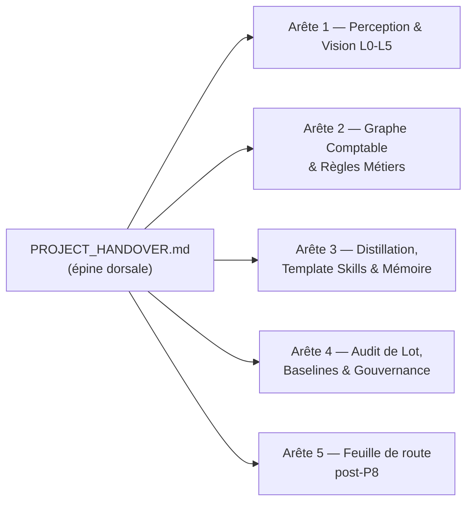

# DSH-Core — PROJECT_HANDOVER (Épine dorsale)

> **RÈGLE DE NAVIGATION** : ce document est le **seul point d'entrée maître** (architecture « arête de poisson » / Hub & Spoke).
> Un humain ou un agent IA qui lit UNIQUEMENT ce fichier doit : (1) connaître l'état exact du projet,
> (2) voir la cartographie complète des documents, (3) savoir QUEL document secondaire lire et pourquoi,
> (4) retrouver les dépendances code/tests de chaque domaine. Toute branche (`docs/*.md`) pointe en
> retour vers ce fichier via son bloc de métadonnées `master_doc`.

---

## 1. ÉTAT DE SANTÉ & LIGNE DE BASE ACTUELLE

| Indicateur | Valeur de référence |
|---|---|
| **Socle Document & Vision Pipeline** | **v1.0.1 — GELÉ DÉFINITIVEMENT** (Phases P0→P8 + P8.1) |
| Contrat | `docs/DOCUMENT_PERCEPTION_CONTRACT.md` v1.0.1 (FROZEN) |
| **Persistance Qdrant / Neo4j** | **v1.0.2 FROZEN** — P9.1→P9.4 et isolation multi-tenant P10.1 |
| Contrat de persistance | `docs/PERSISTENCE_QDRANT_NEO4J_CONTRACT.md` v1.0.2 (FROZEN) |
| **Noyau gelé** | Perception et pipeline facture v1.0.1 ; persistance v1.0.2 — toute évolution = phase + migration + incrément de version |
| **Arête 5** | **v1.0.2 FROZEN** — ontologie Neo4j `Tenant`/`Supplier`/`Invoice`/`InvoiceLine`/`RuleOutcome`, correction E4, payload Qdrant strict `InvoiceVectorPayloadV1` et identifiants isolés par tenant |
| Phases P10 / P11 | **Terminées** — isolation multi-tenant, registre de règles cloisonné et rapprochement bancaire avec arbitrage HITL |
| Suite de tests | **2 486 tests passés** hors-ligne, 2 skips conditionnés, 0 échec (`.\.venv-v3\Scripts\python.exe -m pytest tests -q`) |
| Batch audit (69 docs) | **Parité 100 %** : 29 VALIDATED / 40 HITL / 0 REJECTED (off == on) |
| Performance perception | 12,4 s / 69 docs = **180 ms/doc** — dérogation validée (off = 1,5 s mais sans perception L1-L5) |
| Fast-path L0 | Actif sur **60/69** docs (0 rasterisation, 1 passe de routage, deskew borné) |
| Baseline signée | `workspace/invoices/audit/baseline.json` (run `p8-1-final2`, git `f10de1e`) |
| Template Skills | `workspace/skills/` : `invoice_smtrt_sas.json` v2, `invoice_edf.json`, `invoice_crisol_color.json` (SUP_0002) |
| Mémoire fournisseurs | `workspace/suppliers/suppliers.json` (SMTRT SUP_0001, CRISOL COLOR SUP_0002 / ESB17443482) |
| Assainissement Qdrant P9.4 | **0 point, 0 non conforme, 0 candidat de purge** — purge effectuée : **0 point legacy restant**, dossier `docker/qdrant_storage` supprimé |
| Neo4j legacy | `services/neo4j_service.py` et `repositories/graph_repository.py` : **NON BRANCHÉS** (aucun appelant raccordé ; hors contrat unifié) |

### Chantiers terminés (faits acquis)
- **P0-P8.1** : contrats `DocumentPerception`/`VisualAnnotation` (L1), géométrie + fast-path (L0), routeur (L2), extracteurs PyMuPDF/Pandas/Docling/PaddleOCR (L3), annotations (L4), moteurs symétriques Local/Cloud/Hybrid + façade `perceive_document` (L5), rebranchement `invoice_graph` + `run_batch_audit`, distillation Template Skills (teacher Gemini), gel contractuel.
- **P9.1-P9.4** : persistance unifiée Qdrant/Neo4j, ontologie `Tenant`/`Supplier`/`Invoice`/`InvoiceLine`/`RuleOutcome`, payload `InvoiceVectorPayloadV1`, correction E4 (suppression de l'écrasement `Product`), tests déterministes hors-ligne et assainissement Qdrant.
- **P10.1** : contrat de persistance v1.0.2 FROZEN ; `invoice_id`, `line_id` et `point_id` sont dérivés de `tenant_id` et `source_sha256` pour prévenir les collisions inter-tenants ; garanties couvertes par `tests/test_multitenant_isolation.py` (61 tests).
- **P10.2** : middleware ASGI pur `TenantContextMiddleware` pour contrôler l'en-tête `X-Tenant-ID`, rejeter précocement les requêtes invalides et exposer le tenant dans le `ContextVar` ; point d'entrée FastAPI `backend/app/main.py` ; couverture exhaustive dans `tests/test_tenant_middleware_exhaustive.py` (39 tests).
- **P10.3** : `RuleRegistryService` charge les règles communes depuis `knowledge/rules/common/` et les règles tenant depuis `knowledge/rules/tenants/{tenant_id}/`, avec protection contre la traversée de répertoire.
- **P11.1** : `POST /reconciliation/arbitrate` arbitre les opérations via `ATTACH_INVOICE`, `PERSONAL_EXPENSE` (comptes 108/455) ou `VALIDATE_WITHOUT_INVOICE`.
- **P11.2** : `ObsidianCandidateRuleWriter` persiste physiquement les règles candidates au format Markdown avec frontmatter YAML.
- **P11.3** : `GET /reconciliation/lines` fournit une consultation paginée avec filtres, recherche plein texte et mapping des statuts.
- **P11.4** : composants React / Next.js de rapprochement : `frontend/types/reconciliation.ts`, `frontend/components/reconciliation/ArbitrationModal.tsx` et `frontend/components/reconciliation/ReconciliationTable.tsx`.
- Mémoire fournisseur certifiée (résolution SIREN→TVA→nom, backfill, anti-corruption `IDENTITY_CONFLICT`).
- Escalade cloud stricte (`SUPERVISOR_ESCALATION_MARKERS`) + `CloudEscalationBudget` entier (`budget_max`), superviseur Gemini 3.8 Flash.
- Normalisation pays ISO-2, `tax_amount=null` → HITL `TAX_AMOUNT_UNKNOWN`.
- Benchmark orientation (PP-LCNet 8/10 provisoire, LightOnOCR rejeté), dataset OCR gelé `benchmarks/data/ocr_baseline_texts.json` (60 champs de vérité terrain à valider humainement).

- **Clôture P9.1→P9.4** : phases closes définitivement ; Qdrant purgé (0 point legacy), `docker/qdrant_storage` supprimé ; `services/neo4j_service.py` et `repositories/graph_repository.py` restent **non branchés** (voir `docs/PERSISTENCE_QDRANT_NEO4J_CONTRACT.md`).

### Suites de tests exhaustives (hors-ligne, sans réseau)
| Suite | Tests |
|---|---|
| `tests/test_banking_producer_exhaustive.py` | 171 |
| `tests/test_spreadsheet_producer_exhaustive.py` | 141 |
| `tests/test_rule_registry_exhaustive.py` | 159 |
| `tests/test_vision_budget_supervisor_exhaustive.py` | 80 |
| `tests/test_document_router_exhaustive.py` | 58 |
| `tests/test_multitenant_isolation.py` (P10.1) | 61 |
| `tests/test_tenant_middleware_exhaustive.py` (P10.2) | 39 |

### ROADMAP RESTANTE
- **P10 — Terminée** : P10.1 persistance v1.0.2 FROZEN et identifiants isolés par tenant ; P10.2 middleware ASGI `TenantContextMiddleware` avec contrôle `X-Tenant-ID` / `ContextVar` ; P10.3 `RuleRegistryService` hiérarchique avec protection anti-traversée.
- **P11 — Terminée** : P11.1 endpoint d'arbitrage HITL ; P11.2 persistance des règles candidates Obsidian ; P11.3 endpoint paginé de consultation/recherche ; P11.4 interface React / Next.js de rapprochement bancaire.
- **P12 — Pipeline d'export comptable** : génération FEC conforme ; connecteurs/intégration ERP et logiciels comptables ; contrôles d'équilibre débit/crédit avant export.
- **Transverse** (voir `docs/NEXT_ACTIONS.md`) : agent d'édition documentaire, validation humaine des orientations et de la vérité terrain OCR, éventuelle décision sur le code Neo4j legacy.

---

## 2. SCHÉMA EN ARÊTE DE POISSON & TABLE DE ROUTAGE DOCUMENTAIRE



```
        Arête 1            Arête 2             Arête 3            Arête 4             Arête 5
    Perception L0-L5   Graphe Comptable    Skills & Mémoire   Audit & Baselines   Post-P8
          │                  │                   │                  │                │
          ▼                  ▼                   ▼                  ▼                ▼
  DOCUMENT_PERCEPT..   PIPELINE_FACTURE..  TEMPLATE_SKILLS..  BATCH_AUDIT_..    NEXT_ACTIONS.md
  _CONTRACT.md         V1.md               MEMORY.md          BASELINE.md
          │                  │                   │                  │                │
   schemas/document_*  invoice_graph.py    template_skill_    run_batch_audit   Qdrant, Neo4j,
   services/document_* tva_zero_rule_      store.py           .py, baseline.    tableurs/banque,
   (geometry, router,  evaluator.py,       suppliers.json     json,             HITL, agent
   extractors, annot,  invoice_producer_   workspace/skills/  CloudEscalation   d'édition
   engine, pipeline)   protocol.py,        supplier_identity  Budget, Gemini
                       rule_registry       _schema            supervisor
═══════════════════════════════════════════════════════════════════════════════════════
                            PROJECT_HANDOVER.md (ce document)
```

### Table de routage : QUEL document lire, POURQUOI, avec QUEL code

| # | Arête | Document à lire | Pourquoi le lire | Code / schémas / tests dont il dépend |
|---|---|---|---|---|
| **1** | **Perception & Vision (L0-L5)** | `docs/DOCUMENT_PERCEPTION_CONTRACT.md` (**FROZEN v1.0.1**) | Contrat universel : géométrie (fast-path, clockwise), schémas `DocumentPerception`/`VisualAnnotation`, routeur, extracteurs, annotations, moteurs, pipeline — toute évolution passe par ici | `schemas/document_perception.py`, `schemas/profile_schema.py`, `services/document_geometry.py`, `document_router.py`, `document_extractors.py`, `annotation_perception.py`, `document_engine.py`, `document_pipeline.py` → tests `test_document_*.py`, `test_annotation_perception.py` (13 fichiers) |
| **2** | **Graphe Comptable & Règles Métiers** | `docs/PIPELINE_FACTURE_V1.md` + `knowledge/rules/accounting/RULE_TVA_ZERO_DISAMBIGUATION_001.md` | Chaîne métier : `invoice_graph` (triage→production→supplier_enrichment→validation→règles→commit/HITL), contrat `InvoiceSchema`, règles Obsidian TVA | `backend/app/graphs/invoice_graph.py`, `services/invoice_producer_protocol.py`, `services/tva_zero_rule_evaluator.py`, `services/rule_registry_service.py`, `schemas/invoice_schema.py`, `schemas/rule_registry_schema.py` → tests `test_invoice_graph*.py`, `test_invoice_pipeline_chain.py`, `test_invoice_producers.py`, `test_rule_registry_service.py`, `test_run_pipeline_pilot.py`, `test_invoice_schema.py` |
| **3** | **Distillation, Template Skills & Mémoire Fournisseur** | `docs/TEMPLATE_SKILLS_MEMORY.md` (+ annexe `docs/SUPPLIER_SKILL_MIGRATION_SPEC.md`) | Skills distillés (teacher Gemini → extraction déterministe sans LLM), store/indexation, mémoire fournisseur certifiée, anti-corruption d'identité | `services/template_skill_store.py`, `services/supplier_memory_service.py`, `services/supplier_repository.py`, `schemas/supplier_identity_schema.py`, `workspace/skills/*.json`, `workspace/suppliers/suppliers.json` → tests `test_skill_distillation.py`, `test_supplier_enrichment.py`, `test_supplier_identity_repository.py` |
| **4** | **Audit de Lot, Baselines & Gouvernance Cloud/Local** | `docs/BATCH_AUDIT_BASELINE.md` (+ annexe `docs/AI_MODEL_ROUTING_AND_HARNESSES.md`) | Batch audit (décisions, règles, blocages, perception), baseline signée, budget d'escalade, superviseur Gemini, dérogation perf | `scripts/run_batch_audit.py`, `services/cloud_vision_extractor.py`, `model_router.py`, `workspace/invoices/audit/baseline.json`, rapports `report.md` → tests `test_run_batch_audit.py`, `test_vision_supervisor.py`, `test_model_router.py` |
| **5** | **Persistance & Mémoire Métier (Arête 5)** | `docs/PERSISTENCE_QDRANT_NEO4J_CONTRACT.md` (**FROZEN v1.0.2**) + `docs/collections_qdrant.md` + `docs/NEXT_ACTIONS.md` (feuille de route) | Contrat Qdrant/Neo4j : payload `InvoiceVectorPayloadV1`, ontologie `Tenant`/`Supplier`/`Invoice`/`InvoiceLine`/`RuleOutcome`, identifiants inter-tenants, correction E4, assainissement Qdrant ; chantiers restants : tableurs/banque, HITL, agent d'édition, vérité terrain OCR | `services/persistence_manager.py`, `schemas/vector_payload_schema.py`, `tools/audit_qdrant_collections.py`, `services/spreadsheet_invoice_producer.py`, `services/banking_invoice_producer.py`, `schemas/master_tables_schema.py` → tests `test_persistence_manager.py`, `test_qdrant_audit_service.py`, `tests/test_multitenant_isolation.py`, `tests/test_tenant_middleware_exhaustive.py`, `test_spreadsheet_producer.py`, `test_banking_producer.py` |

**Annexes actives** : `docs/PERSISTENCE_QDRANT_NEO4J_CONTRACT.md`, `docs/collections_qdrant.md`, inventaires racine `QDRANT_INVENTORY.md` et `NEO4J_INVENTORY.md`.

**Annexes historiques** (consulter seulement si besoin rétrospectif) : `docs/PROJECT_STATE.md`, `docs/PROJECT_DECISIONS.md`, `docs/02_ROADMAP.md` (9 phases), `docs/DSH_CORE_AI_ARCHITECTURE_V2.md`, `docs/agents.md`, archives numérotées `docs/00_*` à `docs/06_*`, `BANKING_*.md`.

---

## 3. MATRICE UNIVERSELLE DES DÉPENDANCES (Code ↔ Doc ↔ Tests)

| Fichier source | Imports / dépendances amont | Consommateurs aval | Tests garants | Documentation |
|---|---|---|---|---|
| `schemas/document_perception.py` | pydantic, `schemas/profile_schema.py`, `schemas/document_result.py` | `document_router`, `document_extractors`, `annotation_perception`, `document_engine`, `template_skill_store` | `tests/test_document_perception.py` | Arête 1 |
| `schemas/profile_schema.py` | pydantic | `document_profiler`, `document_router` | `tests/test_document_perception.py`, `tests/test_document_router.py` | Arête 1 |
| `schemas/invoice_schema.py` | pydantic | `invoice_producer_protocol`, `tva_zero_rule_evaluator`, `invoice_graph`, `supplier_memory_service` | `tests/test_invoice_schema.py` | Arête 2 |
| `schemas/rule_registry_schema.py` | pydantic | `rule_registry_service`, `tva_zero_rule_evaluator` | `tests/test_rule_registry_service.py` | Arête 2 |
| `schemas/supplier_identity_schema.py` | pydantic | `supplier_memory_service`, `template_skill_store`, `invoice_party_supplier_identity_adapter` | `tests/test_supplier_identity_repository.py`, `tests/test_supplier_enrichment.py` | Arête 3 |
| `services/document_geometry.py` | pymupdf, cv2 (lazy), `benchmarks/orientation_benchmark` | `document_router`, `document_engine` | `tests/test_document_geometry.py`, `tests/test_document_geometry_fastpath.py` | Arête 1 |
| `services/document_router.py` | `document_profiler`, `document_geometry`, `schemas/document_perception` | `invoice_graph` (triage_node), `document_engine` | `tests/test_document_router.py`, `tests/test_document_router_exhaustive.py` | Arête 1 |
| `services/document_extractors.py` | pymupdf, pandas/docling/paddleocr (lazy), `local_invoice_extractor` | `document_engine` | `tests/test_document_extractors.py` | Arête 1 |
| `services/annotation_perception.py` | pymupdf, `schemas/document_perception` | `document_engine`, `template_skill_store` | `tests/test_annotation_perception.py` | Arête 1 |
| `services/document_engine.py` | géométrie + routeur + extracteurs + annotations + `template_skill_store` + `cloud_vision_extractor` | `document_pipeline` | `tests/test_document_engine.py`, `tests/test_skill_distillation.py` | Arête 1 |
| `services/document_pipeline.py` | `document_engine`, `cloud_vision_extractor` (budget) | `invoice_producer_protocol` (bridge), `invoice_graph`, `run_batch_audit` | `tests/test_document_pipeline.py`, `tests/test_invoice_graph_perception.py` | Arête 1 |
| `services/invoice_producer_protocol.py` | `schemas/invoice_schema`, `document_pipeline` | `invoice_graph`, `run_batch_audit` | `tests/test_invoice_producers.py`, `tests/test_run_batch_audit.py` | Arête 2 |
| `services/tva_zero_rule_evaluator.py` | `rule_registry_service`, `schemas/invoice_schema`, `knowledge/rules/accounting/` | `invoice_graph` (rule_evaluation) | `tests/test_run_pipeline_pilot.py` | Arête 2 |
| `services/rule_registry_service.py` | `schemas/rule_registry_schema`, YAML frontmatter Obsidian | `tva_zero_rule_evaluator`, `run_batch_audit` | `tests/test_rule_registry_service.py` | Arête 2 |
| `services/template_skill_store.py` | `schemas/supplier_identity_schema`, `supplier_repository`, `schemas/document_perception` | `document_engine` (préfiltre LLM) | `tests/test_skill_distillation.py` | Arête 3 |
| `services/supplier_memory_service.py` | `supplier_repository`, `schemas/invoice_schema` | `invoice_graph` (supplier_enrichment) | `tests/test_supplier_enrichment.py` | Arête 3 |
| `services/supplier_repository.py` | JSON `workspace/suppliers/suppliers.json` | `supplier_memory_service`, `template_skill_store`, `invoice_skill_creator` | `tests/test_supplier_enrichment.py` | Arête 3 |
| `services/cloud_vision_extractor.py` | `model_router`, `local_invoice_extractor`, OpenRouter | `document_engine` (Hybrid/Cloud), `run_batch_audit` | `tests/test_vision_supervisor.py`, `tests/test_invoice_producers.py` | Arête 4 |
| `model_router.py` | environnement (aucun réseau) | `cloud_vision_extractor`, `local_invoice_extractor`, `ollama_vision_extractor`, `routing_engine` | `tests/test_model_router.py` | Arête 4 |
| `backend/app/graphs/invoice_graph.py` | `invoice_producer_protocol`, `supplier_memory_service`, `tva_zero_rule_evaluator`, `document_router`, `document_pipeline`, `persistence_manager` | `run_batch_audit`, `backend/app/n8n_api.py` | `tests/test_invoice_graph.py`, `tests/test_invoice_pipeline_chain.py`, `tests/test_invoice_graph_perception.py` | Arête 2 |
| `scripts/run_batch_audit.py` | `invoice_graph`, `rule_registry_service`, `document_pipeline`, `cloud_vision_extractor` (budget) | rapports `workspace/invoices/audit/`, `baseline.json` | `tests/test_run_batch_audit.py` | Arête 4 |
| `services/spreadsheet_invoice_producer.py` | pandas/openpyxl (lazy) | ingestion tableur (Arête 5) | `tests/test_spreadsheet_producer.py` | Arête 5 |
| `services/banking_invoice_producer.py` | pandas (lazy), OFX natif | ingestion bancaire (Arête 5) | `tests/test_banking_producer.py` | Arête 5 |
| `services/persistence_manager.py` | Neo4j, Qdrant, `schemas/vector_payload_schema.py` | `invoice_graph` (commit) | `tests/test_persistence_manager.py`, `tests/test_qdrant_audit_service.py` | Arête 5 |
| `schemas/vector_payload_schema.py` | pydantic | `persistence_manager`, `audit_qdrant_collections` | `tests/test_vector_payload_schema.py`, `tests/test_persistence_manager.py` | Arête 5 |
| `tools/audit_qdrant_collections.py` | qdrant_client, `schemas/vector_payload_schema.py` | audit/assainissement Qdrant | `tests/test_qdrant_audit_service.py` | Arête 5 |
| `services/neo4j_service.py`, `repositories/graph_repository.py` | neo4j (legacy) | **aucun appelant raccordé** | — | Arête 5 (legacy, voir contrat) |

---

## 4. RÈGLES OPÉRATIONNELLES IMMÉDIATES (non négociables)

1. **Python** : toute commande DSH-Core utilise explicitement `A:\dsh-core\.venv-v3\Scripts\python.exe`.
2. **Sécurité** : ne jamais afficher ni recopier les valeurs du `.env` ; aucun texte OCR réel vers Gemini/Copilot/cloud sans règle explicite.
3. **Non-régression** : `pytest tests -q` = **2 486 tests passés hors-ligne, 2 skips conditionnés, 0 échec** ; contrat perception v1.0.1 et contrat persistance v1.0.2 gelés (toute évolution = phase + migration + incrément).
4. **Perception** : `DOCUMENT_PIPELINE=on` par défaut (opt-out `off`) ; `include_vector_drawings=False` en batch ; escalade cloud stricte (`SUPERVISOR_ESCALATION_MARKERS`) budgétée (`budget_max` entier).
5. **Gouvernance règles/skills** : une règle Obsidian ou un `SupplierLayoutRule` ne devient `approved`/`active` qu'après confirmation humaine avec incrémentation de version.
6. **Workflow documentaire** : toute nouvelle documentation vit dans `docs/`, porte le bloc de métadonnées `master_doc: PROJECT_HANDOVER.md`, et est référencée dans la table de routage ci-dessus.

---

*Source de vérité exécutive — le handover dit quoi lire ensuite ; les documents techniques spécialisés disent comment. Ne jamais relire tout le dépôt.*
