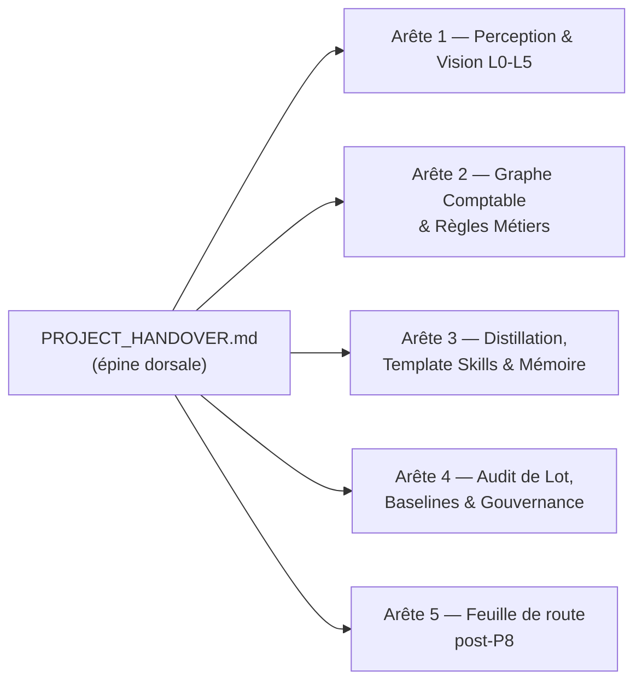

# DSH-Core — PROJECT_HANDOVER (Épine dorsale)

> **RÈGLE DE NAVIGATION** : ce document est le **seul point d'entrée maître** (architecture « arête de poisson » / Hub & Spoke).
> Un humain ou un agent IA qui lit UNIQUEMENT ce fichier doit : (1) connaître l'état exact du projet,
> (2) voir la cartographie complète des documents, (3) savoir QUEL document secondaire lire et pourquoi,
> (4) retrouver les dépendances code/tests de chaque domaine. Toute branche (`docs/*.md`) pointe en
> retour vers ce fichier via son bloc de métadonnées `master_doc`.

---

## 1. ÉTAT DE SANTÉ & LIGNE DE BASE ACTUELLE

| Indicateur | Valeur de référence |
|---|---|
| **Socle Document & Vision Pipeline** | **v1.0.1 — GELÉ DÉFINITIVEMENT** (Phases P0→P8 + P8.1) |
| Contrat | `docs/DOCUMENT_PERCEPTION_CONTRACT.md` v1.0.1 (FROZEN) |
| **Persistance Qdrant / Neo4j** | **v1.0.2 FROZEN** — P9.1→P9.4 et isolation multi-tenant P10.1 |
| Contrat de persistance | `docs/PERSISTENCE_QDRANT_NEO4J_CONTRACT.md` v1.0.2 (FROZEN) |
| **Noyau gelé** | Perception et pipeline facture v1.0.1 ; persistance v1.0.2 — toute évolution = phase + migration + incrément de version |
| **Arête 5** | **v1.0.2 FROZEN** — ontologie Neo4j `Tenant`/`Supplier`/`Invoice`/`InvoiceLine`/`RuleOutcome`, correction E4, payload Qdrant strict `InvoiceVectorPayloadV1` et identifiants isolés par tenant |
| Phases P10→P17 | **Terminées** — isolation multi-tenant, rapprochement bancaire avec arbitrage HITL, exports comptables, persistance SQLite, ingestion bancaire, machine à états OneDrive / Gmail, Vault Obsidian, ingestion automatique `00_INBOX`, watcher de production, exports analytiques et spécialisation métier APD |
| **Chaîne de production** | **P14 / P15 / P16 / P17 : TERMINÉE** — P14.1→P14.5 (machine à états, classeur `_A_COMPLETER.xlsx`, synchronisation bidirectionnelle, ingestion `00_INBOX`, rafraîchissement automatique des exports), P15.1→P15.3 (Vault Obsidian, workflows `instructions.md`, watcher d'arrière-plan), P16.1→P16.2 (synthèses par catégorie, grand livre fournisseur) et P17 (profil APD, connecteur mail manuel, 4 sous-catégories de frais, 2 tableaux mères, anti-doublon TVA et bascule d'exercice) ; pont Vault (`services/vault_accounting_bridge.py`) et auto-export (`CategorySummaryExporter` / `SupplierLedgerExporter` / `07-compta/Cockpit_Compta.md`) branchés sur le watcher |
| Suite de tests | **3254 tests passés** hors-ligne, 2 conditionnés, 0 échec (`.\.venv-v3\Scripts\python.exe -m pytest tests -q`) — baseline 3241 (4daf085), +13 tests P17.1 (dépenses compte dirigeant + Soirée Étape / CGI Art. 206) |
| Batch audit (69 docs) | **Parité 100 %** : 29 VALIDATED / 40 HITL / 0 REJECTED (off == on) |
| Performance perception | 12,4 s / 69 docs = **180 ms/doc** — dérogation validée (off = 1,5 s mais sans perception L1-L5) |
| Fast-path L0 | Actif sur **60/69** docs (0 rasterisation, 1 passe de routage, deskew borné) |
| Baseline signée | `workspace/invoices/audit/baseline.json` (run `p8-1-final2`, git `f10de1e`) |
| Template Skills | `workspace/skills/` : `invoice_smtrt_sas.json` v2, `invoice_edf.json`, `invoice_crisol_color.json` (SUP_0002) |
| Mémoire fournisseurs | `workspace/suppliers/suppliers.json` (SMTRT SUP_0001, CRISOL COLOR SUP_0002 / ESB17443482) |
| Assainissement Qdrant P9.4 | **0 point, 0 non conforme, 0 candidat de purge** — purge effectuée : **0 point legacy restant**, dossier `docker/qdrant_storage` supprimé |
| Neo4j legacy | `services/neo4j_service.py` et `repositories/graph_repository.py` : **NON BRANCHÉS** (aucun appelant raccordé ; hors contrat unifié) |

### Chantiers terminés (faits acquis)
- **P0-P8.1** : contrats `DocumentPerception`/`VisualAnnotation` (L1), géométrie + fast-path (L0), routeur (L2), extracteurs PyMuPDF/Pandas/Docling/PaddleOCR (L3), annotations (L4), moteurs symétriques Local/Cloud/Hybrid + façade `perceive_document` (L5), rebranchement `invoice_graph` + `run_batch_audit`, distillation Template Skills (teacher Gemini), gel contractuel.
- **P9.1-P9.4** : persistance unifiée Qdrant/Neo4j, ontologie `Tenant`/`Supplier`/`Invoice`/`InvoiceLine`/`RuleOutcome`, payload `InvoiceVectorPayloadV1`, correction E4 (suppression de l'écrasement `Product`), tests déterministes hors-ligne et assainissement Qdrant.
- **P10.1** : contrat de persistance v1.0.2 FROZEN ; `invoice_id`, `line_id` et `point_id` sont dérivés de `tenant_id` et `source_sha256` pour prévenir les collisions inter-tenants ; garanties couvertes par `tests/test_multitenant_isolation.py` (61 tests).
- **P10.2** : middleware ASGI pur `TenantContextMiddleware` pour contrôler l'en-tête `X-Tenant-ID`, rejeter précocement les requêtes invalides et exposer le tenant dans le `ContextVar` ; point d'entrée FastAPI `backend/app/main.py` ; couverture exhaustive dans `tests/test_tenant_middleware_exhaustive.py` (39 tests).
- **P10.3** : `RuleRegistryService` charge les règles communes depuis `knowledge/rules/common/` et les règles tenant depuis `knowledge/rules/tenants/{tenant_id}/`, avec protection contre la traversée de répertoire.
- **P11.1** : `POST /reconciliation/arbitrate` arbitre les opérations via `ATTACH_INVOICE`, `PERSONAL_EXPENSE` (comptes 108/455) ou `VALIDATE_WITHOUT_INVOICE`.
- **P11.2** : `ObsidianCandidateRuleWriter` persiste physiquement les règles candidates au format Markdown avec frontmatter YAML.
- **P11.3** : `GET /reconciliation/lines` fournit une consultation paginée avec filtres, recherche plein texte et mapping des statuts.
- **P11.4** : composants React / Next.js de rapprochement : `frontend/types/reconciliation.ts`, `frontend/components/reconciliation/ArbitrationModal.tsx` et `frontend/components/reconciliation/ReconciliationTable.tsx`.
- **P12.1** : moteur officiel FEC A.47 A-1 dans `services/fec_export_service.py`, validation des 18 colonnes et équilibre strict Débit = Crédit ; export via `GET /accounting/export/fec`.
- **P12.2** : moteur CSV de révision comptable et de relevé des arbitrages dans `services/accounting_spreadsheet_export_service.py`, avec neutralisation des injections de formules ; export via `GET /accounting/export/spreadsheet`.
- **P12.3** : barre d'actions d'export dans `frontend/components/reconciliation/ReconciliationTable.tsx`, avec filtres de dates et téléchargement des réponses sous forme de blob.
- **P13.1** : store SQLite multi-tenant hermétique dans `services/sqlite_accounting_store.py`, unifiant les contrats `FecEntryStore` et `ArbitrationStore` (isolation par tenant, transactions et erreurs typées) ; couverture dans `tests/test_sqlite_accounting_store_exhaustive.py`.
- **P13.2** : parseur bancaire multi-formats dans `services/bank_statement_parser_service.py` (formats de dates, montants, devises, délimiteurs) avec déduplication par hash SHA-256 déterministe ; ingestion via `POST /reconciliation/import` (multipart ou JSON, lignes existantes ignorées) ; couverture dans `tests/test_bank_statement_import_exhaustive.py`.
- **P13.3** : bouton d'upload direct de relevé CSV dans l'interface React (`ReconciliationTable.tsx`), état d'import, rapport `{imported, skipped}` et rechargement automatique de la table.
- **P14.1** : modèle de données de la machine à états OneDrive / Gmail (`schemas/folder_state_schema.py` — 6 états `00_`→`05_`, 8 catégories, `MissingFieldEnum`, `DocumentStatus` avec `REJETE`, `DocumentStateRecord`) et arborescence par tenant (`services/folder_tree_service.py` — `ensure_tree`, racine `DSH_DOCUMENT_FLOW_ROOT`, anti-traversée, `05_ARCHIVE_ERREUR/REJET_MANUEL/`) ; couverture dans `tests/test_folder_state_model_exhaustive.py`.
- **P14.2** : gestionnaire non-destructif `_A_COMPLETER.xlsx` (`services/acompleter_workbook_service.py`) — création automatique (en-têtes normalisés, filtres, volets figés), clé primaire stricte sur le hash SHA-256 (`created` / `updated` / `unchanged` / `preserved`), préservation stricte des statuts humains, détection de verrou Excel `~$*.xlsx` avec `WorkbookLockedError` contrôlée, écriture atomique (`tmp` puis `os.replace`) compatible OneDrive ; couverture dans `tests/test_acompleter_workbook_exhaustive.py`.
- **P14.3** : service de synchronisation bidirectionnelle (`services/folder_sync_service.py`) — détection Humain→Pipeline par `mtime` + SHA-256 du classeur en l'absence de verrou `~$*.xlsx` (skip si inchangé), priorité au déplacement manuel (état/catégorie synchronisés vers `SqliteAccountingStore.upsert_document_line`, `Statut` aligné par `align_statut`), traitement `VALIDE` (persistance puis déplacement atomique `02_`→`03_VALIDE_PRET_FEC/<CATEGORIE>/`) et `REJETE` (`05_ARCHIVE_ERREUR/REJET_MANUEL/` avec traçage), routage des doublons SHA-256 et fichiers illisibles vers `05_ARCHIVE_ERREUR/` ; annule et remplace (`03_VALIDE_PRET_FEC` → `05_ARCHIVE_ERREUR/REJET_MANUEL/`, `SqliteAccountingStore.deactivate_rejected_document` et exclusion stricte du pool de rapprochement / exports CSV et FEC) ; couverture dans `tests/test_folder_sync_service_exhaustive.py`.
- **P14.4** : ingestion automatique `00_INBOX` (`services/inbox_ingestion_service.py`) — parcours du tenant, hash SHA-256, rejet des doublons déjà connus de `SqliteAccountingStore` ou présents sous `05_ARCHIVE_ERREUR` (déplacement tracé, jamais de suppression), déplacement atomique vers `01_EN_COURS`, extraction réelle via `PdfInvoiceProducer`/`services/document_pipeline.py` (texte natif déterministe, repli vision locale lazy pour les scans), routage conditionnel : champs complets + confiance ≥ 0,75 → `03_VALIDE_PRET_FEC/<CATEGORIE>/` + ligne `VALIDE` dans `SqliteAccountingStore` ; champs manquants, catégorie `DIVERS_A_CLASSER` ou confiance faible → `02_A_COMPLETER/` + ligne `EN_ATTENTE` et upsert non destructif `_A_COMPLETER.xlsx` (verrou Excel différé) ; fichier illisible, corrompu ou extraction en échec → `05_ARCHIVE_ERREUR/` ; rapport `InboxIngestionReport` (`scanned`, `duplicates`, `moved_to_03`, `moved_to_02`, `archived`, `rows_written`, `deferred_lock`, `vault_events`, `documents`, `traces`) ; API `process_inbox(paths=None)` (scan complet ou sous-ensemble stabilisé du watcher) ; `scripts/run_e2e_p14_p16.py` branché sur ce service réel (`--extractor pipeline|manifest`, `--stop-at inbox|ingestion|a_completer|valide`) ; couverture dans `tests/test_inbox_ingestion_exhaustive.py` (31 tests).
- **P14.5 — Rafraîchissement automatique de production** : `DocumentFlowWatcher(auto_export=True)` régénère, à chaque cycle ayant validé / déplacé / rejeté au moins une pièce, les synthèses `CategorySummaryExporter` des catégories impactées et le `SupplierLedgerExporter` sous `workspace/exports/accounting/<tenant>/`, puis met à jour `01-contexte/cockpit_compta.md` dans le Vault Obsidian (compteur `02_A_COMPLETER`, dernières pièces validées par catégorie, alertes `residual_delta != 0` via `collect_supplier_diagnostics`) ; toute erreur d'export est capturée dans `WatcherCycleReport.export_errors` sans interrompre le flux documentaire ; option CLI `--no-auto-export` pour désactiver le rafraîchissement.
- **P15.1** : bridge Obsidian Vault (`schemas/obsidian_vault_schema.py` + `services/obsidian_vault_service.py`) — racine `OBSIDIAN_VAULT_PATH` (défaut `workspace/vault`), arborescence `_system/`, `01-contexte/`, `02-projets/`, `03-rag/`, `04-graph/entities/`, `05-memoire/facts/`, `05-memoire/events/`, `06-journal/` et contrat `_system/schema.yaml` (types `fact`/`decision`/`entity`/`rag-chunk`, routage, contraintes `max_hot_context: 2000`, `max_warm_context: 4000`, `one_fact_one_file`, `wikilinks_required`) ; `vault_writer` (`VaultWriter`) exportant faits atomiques (`05-memoire/facts/{entity}/{predicate}.md`, frontmatter YAML complet + `[[wikilinks]]`), entités sans duplication de relations, journal de décisions et `01-contexte/active.md` (projet, 5 dernières décisions, prochaine action) avec **couche de revue humaine stricte** (`source: human` / `locked: true` / `status: preserved` / divergence `content_hash` → `preserved`, octets inchangés) ; `vault_reader` (`VaultReader`) assemblant le contexte par priorité hot/warm/rag avec budgets de tokens et recherche vectorielle injectable ; `chunk_by_heading` (H2/H3, `max_chars=2000`, `overlap=0.15`) et `rag_sync` idempotent par SHA-256 avec client Qdrant injectable/mockable ; couverture dans `tests/test_obsidian_vault_service_exhaustive.py` (162 tests).
- **P15.2** : moteur de tâches déclaratives par dossier `instructions.md` — `schemas/declarative_task_schema.py` (modélisation du dossier projet, `ensure_contained`, parseur tolérant des sections Source/Fichiers, Modifications de contenu, Règles de fusion, Règles de prix et Contraintes, détection déterministe `PDF_PRESENTATION` / `TARIFS_EXCEL`, refus de toute règle de suppression de lignes) ; `services/declarative_tarif_service.py` (fusion Excel **strictement non destructive** : lignes absentes conservées en `inchangé`, ajouts `nouveau` + date, mises à jour `modifié` + `ancien_prix`, déduction bidirectionnelle `prix_kg` ↔ `prix_conditionnement` par le poids avec arrondi half-up, extraction déterministe des PDF fournisseurs, défusion des cellules de données, bordures fines, double bordure d'en-tête, codes en texte, `output/tarifs-mis-a-jour.xlsx` atomique, onglet `Résumé` et journal `log/{date}.md`) ; `services/declarative_pdf_service.py` (extraction texte/blocs PyMuPDF, suppressions / remplacements / ajouts séquentiels, gabarit HTML/CSS avec palette, colonnes et logo `assets/`, renderer injectable, chaîne de repli WeasyPrint → ReportLab → PyMuPDF, `output/resultat.pdf` + HTML + audit) ; `services/instructions_task_engine.py` (dispatch) ; couverture dans `tests/test_declarative_workflows_exhaustive.py` (58 tests).
- **P16** : export analytique de synthèse par catégorie — `CategorySummaryExporter.export_category_summary(tenant_id, category, output_path=None)` dans `services/accounting_spreadsheet_export_service.py`, branché sur `SqliteAccountingStore.list_category_lines` (catégorie explicite ou inférée du segment `<ETAT>/<CATEGORIE>/` de `invoice_url`, isolation tenant) ; exclusion stricte des pièces `REJETE` (y compris après décision d'arbitrage), classeur `openpyxl` normé (colonnes Date pièce / Tiers / N° Pièce / Réf externe / HT / TVA / TTC / Statut lettrage-rapprochement, filtres, volets figés, bordures, largeurs auto-ajustées, ligne `TOTAL` en formules `=SUM`, aucune cellule de données fusionnée, neutralisation des formules injectées) et écriture atomique (`tmp` puis `os.replace`) ; colonnes `category`, `amount_ht`, `amount_tva`, `amount_ttc` ajoutées au store avec migration additive des bases existantes ; couverture dans `tests/test_category_summary_export_exhaustive.py` (48 tests).
- **P16.2** : grand livre auxiliaire par fournisseur — `SqliteAccountingStore.list_supplier_ledger(tenant_id, supplier=None)` et `SupplierLedgerExporter.export_supplier_ledger(tenant_id, supplier_query=None, output_path=None)` dans `services/accounting_spreadsheet_export_service.py` ; un onglet par tiers (ou un tiers filtré), colonnes `Date / Type (FACTURE, AVOIR, PAIEMENT) / N° Pièce-Réf / Libellé / Débit / Crédit / Solde Cumulé / Code Lettrage-Statut`, affichage du numéro de pièce fournisseur extrait du libellé ou des métadonnées (avec repli sur l'UUID tronqué uniquement en l'absence de numéro) dans la synthèse par catégorie et le grand livre, formules Excel de solde progressif (`=F2-E2` puis `=G{n-1}+F{n}-E{n}`), totaux Débit/Crédit/Solde final, marquage vert et commentaire des points d'équilibre (`Solde = 0,00`), filtres, volets figés, aucune fusion de cellules de données et écriture atomique sous `workspace/exports/accounting/<tenant>/` ; exclusion stricte des pièces `REJETE`, des documents non validés et des dépenses personnelles ; diagnostic combinatoire `Factures - Avoirs = Paiement` sur les pièces non lettrées avec recherche exacte (jusqu'à 30 pièces), calcul du `residual_delta` en cas d'absence de combinaison exacte et bandeau `DIAGNOSTIC RAPPROCHEMENT` en bas de chaque onglet ; migration additive de la colonne `document_type` et index fournisseur dans `services/sqlite_accounting_store.py` ; couverture dans `tests/test_supplier_ledger_export_exhaustive.py` (25 tests).
- **P17 — Spécialisation Métier APD** : profil société gelé `APD_PROFILE` (`siren=810908392`, `vat_number=FR11810908392`, `invoice_email=facturesapd@gmail.com`) dans `schemas/folder_state_schema.py` ; connecteur mail **manuel** `services/email_inbox_bridge.py` (`fetch_and_stage_emails`, `sync_email_folder_state`, client IMAP/Gmail injectable, miroirs `00_INBOX`→`05_ARCHIVE_ERREUR`, pièces jointes PDF/images déposées dans `00_INBOX` puis envoyées au pipeline Vision/extraction) ; cockpit Obsidian déplacé dans `07-compta/Cockpit_Compta.md` avec alias `01-contexte/cockpit_compta.md`, liste Markdown cliquable des pièces de `02_A_COMPLETER` et état des rapprochements ; `ExpenseSubCategory` (`RESTAURATION`, `CARBURANT`, `TRANSPORT_PARKING`, `HOTELLERIE`) avec sous-dossiers physiques `03_/04_EXPORT_COMPTA/FRAIS_GENERAUX/<SOUS_CAT>/`, `SYNTHESE_FRAIS_GENERAUX.xlsx` et 4 sous-tableaux Excel dédiés (colonnes Invité/Lieu en restauration, TVA déductible/non déductible en hôtellerie) ; champs `invite_restaurant` / `lieu_restaurant` ajoutés à `MissingFieldEnum` et au classeur `_A_COMPLETER.xlsx` (colonnes P17 additives après les six colonnes gelées) ; tableaux mères `04_EXPORT_COMPTA/<tenant>/TABLEAU_MERE_ACHATS_CHARGES.xlsx` et `TABLEAU_MERE_BANQUE_TVA.xlsx` avec `is_classified_marker` (`IDENTIFIEE_CLASSEE:<SOUS_CAT>` / `NON_CLASSEE`), `tva_dedup_status` (clé numéro de pièce + fournisseur + montant, `TVA_UNIQUE` / `DOUBLON_TVA_EXCLU` / `TVA_NON_VERIFIABLE`, une seule TVA comptée dans `RECAP_TVA`) et bascule d'exercice `fiscal_year_mode` (`PRECEDENT` / `ACTUEL` / `SUIVANT`) + `fiscal_year_target` + `deferred_month_override` (`01` / `02`) isolant strictement charges et TVA dans l'exercice choisi ; migrations additives de toutes ces colonnes dans `SqliteAccountingStore` ; couverture dans `tests/test_p17_apd_business_rules_exhaustive.py` (47 tests).
- **P17.1 — Dépenses payées par le compte personnel du dirigeant & Soirée Étape** : `PaymentSource` (`BANQUE_PRO` / `COMPTE_PERSO_DIRIGEANT`) et compte de contrepartie `455000_DIRIGEANT` dans `schemas/folder_state_schema.py` ; colonne `Source de Paiement` + `Compte de Contrepartie` dans `_A_COMPLETER.xlsx` ; champs `payment_source` / `counterparty_account` migrés dans `SqliteAccountingStore` et propagés par `InboxIngestionService` (validation + ventilation normales, aucun rapprochement bancaire pro requis) ; le grand livre marque ces pièces `HORS_PERIMETRE` (exclues de l'attente `A_RAPPROCHER`) et les tableaux mères exposent le compte `455000_DIRIGEANT` ; `PersonalExpenseNoteExporter` / `export_personal_expense_note` génèrent `workspace/exports/accounting/<tenant>/NOTE_DE_FRAIS_DIRIGEANT_<AAAA-MM>.xlsx` (pièces, HT, TVA déductible, TTC, total net à rembourser, auto-exporté par le watcher) ; `services/hotel_expense_parser.py` détecte la mention « Soirée Étape » et les ventilations hébergement vs restauration/petit-déjeuner, isole la TVA déductible de la TVA non déductible (CGI Art. 206) dans le parseur PDF et le sous-tableau `HOTELLERIE`.
- **P15.1 — Câblage Vault ↔ validation comptable (P14/P16)** : `services/vault_accounting_bridge.py` (`VaultAccountingBridge`, `VaultValidationRecord`, `VaultBridgeReport`) branché sur `InboxIngestionService` (validation directe `03_`) et `FolderSyncService` (`VALIDE` Excel + déplacement manuel) ; chaque pièce validée enrichit `04-graph/entities/{fournisseur}.md` (relations `achat` → `[[piece-...]]`, résumé avec dernière date/montant/catégorie, slugs déterministes `ACME SAS` → `acme-sas`) et écrit un événement daté `05-memoire/events/validation-{document_id}.md` via `VaultWriter.write_event` ; couche de revue humaine inchangée (`source: human` / `locked: true` / `status: preserved` / divergence `content_hash` → `preserved`, octets identiques) ; **échec Vault non bloquant** : toute exception d'écriture est capturée (`written` / `partial` / `failed`), la ligne SQLite et le déplacement du fichier vers `03_VALIDE_PRET_FEC` restent intacts, l'erreur est tracée (`VAULT_ERROR` / `VAULT:failed`).
- **P15.3 — Watcher d'arrière-plan du flux documentaire** : `services/document_flow_watcher.py` (`DocumentFlowWatcher`) surveille en continu `00_INBOX` et le classeur humain ; ingestion uniquement des fichiers dont taille + `mtime` sont stables pendant `settle_delay` (lectures partielles OneDrive/scans évitées) via `InboxIngestionService.process_inbox(paths)` ; chaque cycle `run_once()` enchaîne ingestion stabilisée puis `FolderSyncService.sync_human_to_pipeline()` après contrôle du verrou `~$*.xlsx` (sync différée, cycle non bloquant) ; boucle `run_forever()` avec `poll_interval`, arrêt propre `KeyboardInterrupt` / `SIGINT` / `SIGTERM` et verrou mono-instance `.watcher.lock` par tenant (`WatcherAlreadyRunningError`) ; runner CLI `scripts/run_document_watcher.py --tenant default --interval 5 [--settle-delay 2] [--once] [--no-auto-export]` avec logs concis (détection, routage `02_`/`03_`/`05_`, synchronisation Excel, exports) ; auto-export non bloquant des synthèses / grand livre / cockpit ; couverture dans `tests/test_document_flow_watcher_exhaustive.py` (15 tests).
- Mémoire fournisseur certifiée (résolution SIREN→TVA→nom, backfill, anti-corruption `IDENTITY_CONFLICT`).
- Escalade cloud stricte (`SUPERVISOR_ESCALATION_MARKERS`) + `CloudEscalationBudget` entier (`budget_max`), superviseur Gemini 3.8 Flash.
- Normalisation pays ISO-2, `tax_amount=null` → HITL `TAX_AMOUNT_UNKNOWN`.
- Benchmark orientation (PP-LCNet 8/10 provisoire, LightOnOCR rejeté), dataset OCR gelé `benchmarks/data/ocr_baseline_texts.json` (60 champs de vérité terrain à valider humainement).

- **Clôture P9.1→P9.4** : phases closes définitivement ; Qdrant purgé (0 point legacy), `docker/qdrant_storage` supprimé ; `services/neo4j_service.py` et `repositories/graph_repository.py` restent **non branchés** (voir `docs/PERSISTENCE_QDRANT_NEO4J_CONTRACT.md`).

### Suites de tests exhaustives (hors-ligne, sans réseau)
| Suite | Tests |
|---|---|
| `tests/test_banking_producer_exhaustive.py` | 171 |
| `tests/test_spreadsheet_producer_exhaustive.py` | 141 |
| `tests/test_rule_registry_exhaustive.py` | 159 |
| `tests/test_vision_budget_supervisor_exhaustive.py` | 80 |
| `tests/test_document_router_exhaustive.py` | 58 |
| `tests/test_multitenant_isolation.py` (P10.1) | 61 |
| `tests/test_tenant_middleware_exhaustive.py` (P10.2) | 39 |
| `tests/test_fec_export_exhaustive.py` (P12.1) | 16 |
| `tests/test_accounting_spreadsheet_export_exhaustive.py` (P12.2) | 13 |
| `tests/test_sqlite_accounting_store_exhaustive.py` (P13.1) | 45 |
| `tests/test_bank_statement_import_exhaustive.py` (P13.2) | 95 |
| `tests/test_folder_state_model_exhaustive.py` (P14.1) | 89 |
| `tests/test_acompleter_workbook_exhaustive.py` (P14.2) | 54 |
| `tests/test_folder_sync_service_exhaustive.py` (P14.3) | 47 |
| `tests/test_inbox_ingestion_exhaustive.py` (P14.4) | 31 |
| `tests/test_obsidian_vault_service_exhaustive.py` (P15.1) | 162 |
| `tests/test_vault_accounting_bridge_exhaustive.py` (P15.1 / P14-P16) | 22 |
| `tests/test_document_flow_watcher_exhaustive.py` (P15.3 / P14.5) | 15 |
| `tests/test_declarative_workflows_exhaustive.py` (P15.2) | 58 |
| `tests/test_category_summary_export_exhaustive.py` (P16) | 48 |
| `tests/test_supplier_ledger_export_exhaustive.py` (P16.2) | 25 |
| `tests/test_p17_apd_business_rules_exhaustive.py` (P17) | 47 |

### ROADMAP RESTANTE
- **P10 — Terminée** : P10.1 persistance v1.0.2 FROZEN et identifiants isolés par tenant ; P10.2 middleware ASGI `TenantContextMiddleware` avec contrôle `X-Tenant-ID` / `ContextVar` ; P10.3 `RuleRegistryService` hiérarchique avec protection anti-traversée.
- **P11 — Terminée** : P11.1 endpoint d'arbitrage HITL ; P11.2 persistance des règles candidates Obsidian ; P11.3 endpoint paginé de consultation/recherche ; P11.4 interface React / Next.js de rapprochement bancaire.
- **P12 — Terminée** : P12.1 export officiel FEC A.47 A-1, 18 colonnes et équilibre strict Débit = Crédit ; P12.2 exports CSV de révision comptable et des arbitrages protégés contre l'injection de formules ; P12.3 barre d'export avec filtres de dates et téléchargement blob.
- **P13 — Terminée** : P13.1 store SQLite multi-tenant hermétique unifiant `FecEntryStore` et `ArbitrationStore` ; P13.2 parseur bancaire multi-formats avec déduplication SHA-256 déterministe et `POST /reconciliation/import` ; P13.3 bouton d'upload direct de relevé CSV dans l'interface React avec rapport d'ingestion.
- **P14 — Terminée** (spec : `docs/P14_P15_SPECIFICATION.md`) : P14.1 **terminé** (modèle `schemas/folder_state_schema.py` + arborescence `services/folder_tree_service.py`, décision `DSH_DOCUMENT_FLOW_ROOT` / isolation tenant) ; P14.2 **terminé** (gestionnaire `_A_COMPLETER.xlsx` `services/acompleter_workbook_service.py`, clé primaire stricte SHA-256, préservation des statuts humains, verrou `~$*.xlsx` → `WorkbookLockedError`, écriture atomique `os.replace`) ; P14.3 **terminé** (synchronisation `services/folder_sync_service.py`, détection `mtime` + SHA-256, déplacement manuel prioritaire, `VALIDE` → `03_/<CATEGORIE>/` + `SqliteAccountingStore.upsert_document_line`, `REJETE` → `05_/REJET_MANUEL/` ; annule et remplace `03_VALIDE_PRET_FEC` → `05_/REJET_MANUEL/` avec `deactivate_rejected_document` et exclusion du pool / exports) ; P14.4 **terminé** (ingestion automatique `services/inbox_ingestion_service.py` : SHA-256, doublons store/archive, `00_`→`01_` atomique, extraction réelle `PdfInvoiceProducer`/`document_pipeline`, routage `03_`/`02_`+Excel/`05_`, rapport tracé, runner E2E branché) ; P14.5 **terminé** (rafraîchissement automatique des synthèses `CategorySummaryExporter`, du `SupplierLedgerExporter` et du cockpit `01-contexte/cockpit_compta.md` par `DocumentFlowWatcher(auto_export=True)`, erreurs non bloquantes, option `--no-auto-export`).
- **P15 — Terminée** (spec : `docs/P14_P15_SPECIFICATION.md`) : P15.1 **terminé** (bridge Obsidian Vault `schemas/obsidian_vault_schema.py` + `services/obsidian_vault_service.py` — arborescence `OBSIDIAN_VAULT_PATH`, contrat `_system/schema.yaml`, `vault_writer` avec couche de revue humaine (`preserved` sur `source: human` / `locked` / divergence), `vault_reader` hot/warm/rag avec budgets de tokens, `chunk_by_heading` H2/H3 et `rag_sync` idempotent par SHA-256 avec Qdrant mockable ; câblage comptable `services/vault_accounting_bridge.py` sur `InboxIngestionService` / `FolderSyncService`, entité fournisseur + événement daté non bloquants) ; P15.2 **terminé** (moteur `instructions.md` : `schemas/declarative_task_schema.py`, `services/declarative_tarif_service.py`, `services/declarative_pdf_service.py`, `services/instructions_task_engine.py` — fusion Excel non destructive et refonte PDF/PLV avec fallback de rendu) ; P15.3 **terminé** (watcher `services/document_flow_watcher.py` + `scripts/run_document_watcher.py`, stabilisation taille/mtime, verrou mono-instance, boucle d'ingestion/synchronisation et auto-export non bloquant).
- **P16 — Terminée** : P16.1 export analytique de synthèse par catégorie (`CategorySummaryExporter.export_category_summary`) — interroge le store SQLite par catégorie, exclut strictement `REJETE`, produit un classeur Excel normé avec filtres, bordures, largeurs auto, totaux `SOMME` HT/TVA/TTC et écriture atomique ; P16.2 grand livre auxiliaire par fournisseur (`SupplierLedgerExporter.export_supplier_ledger`) — un onglet par tiers, solde cumulé Débit/Crédit en formules, points d'équilibre, diagnostic combinatoire `Factures - Avoirs = Paiement` et `residual_delta` ; migrations additives `category` / `amount_*` / `document_type` et index fournisseur dans `services/sqlite_accounting_store.py`.
- **P17 — Terminée** : profil APD et connecteur mail manuel (`services/email_inbox_bridge.py`, client IMAP/Gmail injectable, miroirs de dossiers, `fetch_and_stage_emails`, `sync_email_folder_state`) ; cockpit Obsidian `07-compta/Cockpit_Compta.md` + alias `01-contexte/cockpit_compta.md` ; `ExpenseSubCategory` et sous-tableaux Excel dédiés sous `03_/04_EXPORT_COMPTA/FRAIS_GENERAUX/<SOUS_CAT>/` avec `SYNTHESE_FRAIS_GENERAUX.xlsx` ; tableaux mères `TABLEAU_MERE_ACHATS_CHARGES.xlsx` / `TABLEAU_MERE_BANQUE_TVA.xlsx` avec repère de classement, anti-doublon TVA (`numéro pièce + fournisseur + montant`) et bascule d'exercice Janvier/Février (`PRECEDENT` / `ACTUEL` / `SUIVANT`) ; migrations additives correspondantes dans `services/sqlite_accounting_store.py` et colonnes P17 ajoutées à `_A_COMPLETER.xlsx` sans modifier les six colonnes gelées ; P17.1 **terminé** (dépenses `COMPTE_PERSO_DIRIGEANT` sans rapprochement bancaire pro, contrepartie `455000_DIRIGEANT`, notes de frais mensuelles `NOTE_DE_FRAIS_DIRIGEANT_<AAAA-MM>.xlsx`, parseur « Soirée Étape » et TVA hôtelière CGI Art. 206).
- **Transverse** (voir `docs/NEXT_ACTIONS.md`) : agent d'édition documentaire, validation humaine des orientations et de la vérité terrain OCR, éventuelle décision sur le code Neo4j legacy.

---

## 2. SCHÉMA EN ARÊTE DE POISSON & TABLE DE ROUTAGE DOCUMENTAIRE



```
        Arête 1            Arête 2             Arête 3            Arête 4             Arête 5
    Perception L0-L5   Graphe Comptable    Skills & Mémoire   Audit & Baselines   Post-P8
          │                  │                   │                  │                │
          ▼                  ▼                   ▼                  ▼                ▼
  DOCUMENT_PERCEPT..   PIPELINE_FACTURE..  TEMPLATE_SKILLS..  BATCH_AUDIT_..    NEXT_ACTIONS.md
  _CONTRACT.md         V1.md               MEMORY.md          BASELINE.md
          │                  │                   │                  │                │
   schemas/document_*  invoice_graph.py    template_skill_    run_batch_audit   Qdrant, Neo4j,
   services/document_* tva_zero_rule_      store.py           .py, baseline.    tableurs/banque,
   (geometry, router,  evaluator.py,       suppliers.json     json,             HITL, agent
   extractors, annot,  invoice_producer_   workspace/skills/  CloudEscalation   d'édition
   engine, pipeline)   protocol.py,        supplier_identity  Budget, Gemini
                       rule_registry       _schema            supervisor
═══════════════════════════════════════════════════════════════════════════════════════
                            PROJECT_HANDOVER.md (ce document)
```

### Table de routage : QUEL document lire, POURQUOI, avec QUEL code

| # | Arête | Document à lire | Pourquoi le lire | Code / schémas / tests dont il dépend |
|---|---|---|---|---|
| **1** | **Perception & Vision (L0-L5)** | `docs/DOCUMENT_PERCEPTION_CONTRACT.md` (**FROZEN v1.0.1**) | Contrat universel : géométrie (fast-path, clockwise), schémas `DocumentPerception`/`VisualAnnotation`, routeur, extracteurs, annotations, moteurs, pipeline — toute évolution passe par ici | `schemas/document_perception.py`, `schemas/profile_schema.py`, `services/document_geometry.py`, `document_router.py`, `document_extractors.py`, `annotation_perception.py`, `document_engine.py`, `document_pipeline.py` → tests `test_document_*.py`, `test_annotation_perception.py` (13 fichiers) |
| **2** | **Graphe Comptable & Règles Métiers** | `docs/PIPELINE_FACTURE_V1.md` + `knowledge/rules/accounting/RULE_TVA_ZERO_DISAMBIGUATION_001.md` | Chaîne métier : `invoice_graph` (triage→production→supplier_enrichment→validation→règles→commit/HITL), contrat `InvoiceSchema`, règles Obsidian TVA | `backend/app/graphs/invoice_graph.py`, `services/invoice_producer_protocol.py`, `services/tva_zero_rule_evaluator.py`, `services/rule_registry_service.py`, `schemas/invoice_schema.py`, `schemas/rule_registry_schema.py` → tests `test_invoice_graph*.py`, `test_invoice_pipeline_chain.py`, `test_invoice_producers.py`, `test_rule_registry_service.py`, `test_run_pipeline_pilot.py`, `test_invoice_schema.py` |
| **3** | **Distillation, Template Skills & Mémoire Fournisseur** | `docs/TEMPLATE_SKILLS_MEMORY.md` (+ annexe `docs/SUPPLIER_SKILL_MIGRATION_SPEC.md`) | Skills distillés (teacher Gemini → extraction déterministe sans LLM), store/indexation, mémoire fournisseur certifiée, anti-corruption d'identité | `services/template_skill_store.py`, `services/supplier_memory_service.py`, `services/supplier_repository.py`, `schemas/supplier_identity_schema.py`, `workspace/skills/*.json`, `workspace/suppliers/suppliers.json` → tests `test_skill_distillation.py`, `test_supplier_enrichment.py`, `test_supplier_identity_repository.py` |
| **4** | **Audit de Lot, Baselines & Gouvernance Cloud/Local** | `docs/BATCH_AUDIT_BASELINE.md` (+ annexe `docs/AI_MODEL_ROUTING_AND_HARNESSES.md`) | Batch audit (décisions, règles, blocages, perception), baseline signée, budget d'escalade, superviseur Gemini, dérogation perf | `scripts/run_batch_audit.py`, `services/cloud_vision_extractor.py`, `model_router.py`, `workspace/invoices/audit/baseline.json`, rapports `report.md` → tests `test_run_batch_audit.py`, `test_vision_supervisor.py`, `test_model_router.py` |
| **5** | **Persistance & Mémoire Métier (Arête 5)** | `docs/PERSISTENCE_QDRANT_NEO4J_CONTRACT.md` (**FROZEN v1.0.2**) + `docs/collections_qdrant.md` + `docs/NEXT_ACTIONS.md` (feuille de route) | Contrat Qdrant/Neo4j : payload `InvoiceVectorPayloadV1`, ontologie `Tenant`/`Supplier`/`Invoice`/`InvoiceLine`/`RuleOutcome`, identifiants inter-tenants, correction E4, assainissement Qdrant ; chantiers restants : tableurs/banque, HITL, agent d'édition, vérité terrain OCR | `services/persistence_manager.py`, `schemas/vector_payload_schema.py`, `tools/audit_qdrant_collections.py`, `services/spreadsheet_invoice_producer.py`, `services/banking_invoice_producer.py`, `schemas/master_tables_schema.py` → tests `test_persistence_manager.py`, `test_qdrant_audit_service.py`, `tests/test_multitenant_isolation.py`, `tests/test_tenant_middleware_exhaustive.py`, `test_spreadsheet_producer.py`, `test_banking_producer.py` |
| **6** | **P14/P15 — Machine à états documentaire & Vault** | `docs/P14_P15_SPECIFICATION.md` (**ACTIVE**) | Spec formelle : états `00_`→`05_`, 8 catégories, contrat `_A_COMPLETER.xlsx`, synchronisation bidirectionnelle OneDrive / Gmail, bridge Obsidian Vault et workflows `instructions.md` | modules `schemas/folder_state_schema.py`, `services/folder_tree_service.py`, `services/acompleter_workbook_service.py`, `services/folder_sync_service.py`, `schemas/obsidian_vault_schema.py`, `services/obsidian_vault_service.py` (P15.1), `schemas/declarative_task_schema.py`, `services/declarative_tarif_service.py`, `services/declarative_pdf_service.py`, `services/instructions_task_engine.py` (P15.2) → tests `tests/test_folder_state_model_exhaustive.py`, `tests/test_acompleter_workbook_exhaustive.py`, `tests/test_folder_sync_service_exhaustive.py`, `tests/test_obsidian_vault_service_exhaustive.py`, `tests/test_declarative_workflows_exhaustive.py` |

**Annexes actives** : `docs/PERSISTENCE_QDRANT_NEO4J_CONTRACT.md`, `docs/collections_qdrant.md`, `docs/P14_P15_SPECIFICATION.md` (P14/P15), inventaires racine `QDRANT_INVENTORY.md` et `NEO4J_INVENTORY.md`.

**Annexes historiques** (consulter seulement si besoin rétrospectif) : `docs/PROJECT_STATE.md`, `docs/PROJECT_DECISIONS.md`, `docs/02_ROADMAP.md` (9 phases), `docs/DSH_CORE_AI_ARCHITECTURE_V2.md`, `docs/agents.md`, archives numérotées `docs/00_*` à `docs/06_*`, `BANKING_*.md`.

---

## 3. MATRICE UNIVERSELLE DES DÉPENDANCES (Code ↔ Doc ↔ Tests)

| Fichier source | Imports / dépendances amont | Consommateurs aval | Tests garants | Documentation |
|---|---|---|---|---|
| `schemas/document_perception.py` | pydantic, `schemas/profile_schema.py`, `schemas/document_result.py` | `document_router`, `document_extractors`, `annotation_perception`, `document_engine`, `template_skill_store` | `tests/test_document_perception.py` | Arête 1 |
| `schemas/profile_schema.py` | pydantic | `document_profiler`, `document_router` | `tests/test_document_perception.py`, `tests/test_document_router.py` | Arête 1 |
| `schemas/invoice_schema.py` | pydantic | `invoice_producer_protocol`, `tva_zero_rule_evaluator`, `invoice_graph`, `supplier_memory_service` | `tests/test_invoice_schema.py` | Arête 2 |
| `schemas/rule_registry_schema.py` | pydantic | `rule_registry_service`, `tva_zero_rule_evaluator` | `tests/test_rule_registry_service.py` | Arête 2 |
| `schemas/supplier_identity_schema.py` | pydantic | `supplier_memory_service`, `template_skill_store`, `invoice_party_supplier_identity_adapter` | `tests/test_supplier_identity_repository.py`, `tests/test_supplier_enrichment.py` | Arête 3 |
| `services/document_geometry.py` | pymupdf, cv2 (lazy), `benchmarks/orientation_benchmark` | `document_router`, `document_engine` | `tests/test_document_geometry.py`, `tests/test_document_geometry_fastpath.py` | Arête 1 |
| `services/document_router.py` | `document_profiler`, `document_geometry`, `schemas/document_perception` | `invoice_graph` (triage_node), `document_engine` | `tests/test_document_router.py`, `tests/test_document_router_exhaustive.py` | Arête 1 |
| `services/document_extractors.py` | pymupdf, pandas/docling/paddleocr (lazy), `local_invoice_extractor` | `document_engine` | `tests/test_document_extractors.py` | Arête 1 |
| `services/annotation_perception.py` | pymupdf, `schemas/document_perception` | `document_engine`, `template_skill_store` | `tests/test_annotation_perception.py` | Arête 1 |
| `services/document_engine.py` | géométrie + routeur + extracteurs + annotations + `template_skill_store` + `cloud_vision_extractor` | `document_pipeline` | `tests/test_document_engine.py`, `tests/test_skill_distillation.py` | Arête 1 |
| `services/document_pipeline.py` | `document_engine`, `cloud_vision_extractor` (budget) | `invoice_producer_protocol` (bridge), `invoice_graph`, `run_batch_audit` | `tests/test_document_pipeline.py`, `tests/test_invoice_graph_perception.py` | Arête 1 |
| `services/invoice_producer_protocol.py` | `schemas/invoice_schema`, `document_pipeline` | `invoice_graph`, `run_batch_audit` | `tests/test_invoice_producers.py`, `tests/test_run_batch_audit.py` | Arête 2 |
| `services/tva_zero_rule_evaluator.py` | `rule_registry_service`, `schemas/invoice_schema`, `knowledge/rules/accounting/` | `invoice_graph` (rule_evaluation) | `tests/test_run_pipeline_pilot.py` | Arête 2 |
| `services/rule_registry_service.py` | `schemas/rule_registry_schema`, YAML frontmatter Obsidian | `tva_zero_rule_evaluator`, `run_batch_audit` | `tests/test_rule_registry_service.py` | Arête 2 |
| `services/template_skill_store.py` | `schemas/supplier_identity_schema`, `supplier_repository`, `schemas/document_perception` | `document_engine` (préfiltre LLM) | `tests/test_skill_distillation.py` | Arête 3 |
| `services/supplier_memory_service.py` | `supplier_repository`, `schemas/invoice_schema` | `invoice_graph` (supplier_enrichment) | `tests/test_supplier_enrichment.py` | Arête 3 |
| `services/supplier_repository.py` | JSON `workspace/suppliers/suppliers.json` | `supplier_memory_service`, `template_skill_store`, `invoice_skill_creator` | `tests/test_supplier_enrichment.py` | Arête 3 |
| `services/cloud_vision_extractor.py` | `model_router`, `local_invoice_extractor`, OpenRouter | `document_engine` (Hybrid/Cloud), `run_batch_audit` | `tests/test_vision_supervisor.py`, `tests/test_invoice_producers.py` | Arête 4 |
| `model_router.py` | environnement (aucun réseau) | `cloud_vision_extractor`, `local_invoice_extractor`, `ollama_vision_extractor`, `routing_engine` | `tests/test_model_router.py` | Arête 4 |
| `backend/app/graphs/invoice_graph.py` | `invoice_producer_protocol`, `supplier_memory_service`, `tva_zero_rule_evaluator`, `document_router`, `document_pipeline`, `persistence_manager` | `run_batch_audit`, `backend/app/n8n_api.py` | `tests/test_invoice_graph.py`, `tests/test_invoice_pipeline_chain.py`, `tests/test_invoice_graph_perception.py` | Arête 2 |
| `scripts/run_batch_audit.py` | `invoice_graph`, `rule_registry_service`, `document_pipeline`, `cloud_vision_extractor` (budget) | rapports `workspace/invoices/audit/`, `baseline.json` | `tests/test_run_batch_audit.py` | Arête 4 |
| `services/spreadsheet_invoice_producer.py` | pandas/openpyxl (lazy) | ingestion tableur (Arête 5) | `tests/test_spreadsheet_producer.py` | Arête 5 |
| `services/banking_invoice_producer.py` | pandas (lazy), OFX natif | ingestion bancaire (Arête 5) | `tests/test_banking_producer.py` | Arête 5 |
| `services/persistence_manager.py` | Neo4j, Qdrant, `schemas/vector_payload_schema.py` | `invoice_graph` (commit) | `tests/test_persistence_manager.py`, `tests/test_qdrant_audit_service.py` | Arête 5 |
| `schemas/vector_payload_schema.py` | pydantic | `persistence_manager`, `audit_qdrant_collections` | `tests/test_vector_payload_schema.py`, `tests/test_persistence_manager.py` | Arête 5 |
| `tools/audit_qdrant_collections.py` | qdrant_client, `schemas/vector_payload_schema.py` | audit/assainissement Qdrant | `tests/test_qdrant_audit_service.py` | Arête 5 |
| `services/neo4j_service.py`, `repositories/graph_repository.py` | neo4j (legacy) | **aucun appelant raccordé** | — | Arête 5 (legacy, voir contrat) |
| `services/fec_export_service.py` | entrées comptables normalisées | `backend/app/routers/accounting_export.py` (`GET /accounting/export/fec`) | `tests/test_fec_export_exhaustive.py` | P12.1 |
| `services/accounting_spreadsheet_export_service.py` | lignes de rapprochement et arbitrages, `openpyxl`, `schemas/folder_state_schema.py`, `SqliteAccountingStore` (P16) | `backend/app/routers/accounting_export.py` (`GET /accounting/export/spreadsheet`) ; `CategorySummaryExporter.export_category_summary` (classeur analytique par catégorie) ; `SupplierLedgerExporter.export_supplier_ledger` (grand livre auxiliaire par fournisseur, P16.2) ; `ExpenseSubCategoryExporter` (4 sous-tableaux + `SYNTHESE_FRAIS_GENERAUX.xlsx`, P17) ; `MasterTableExporter` (tableaux mères, anti-doublon TVA et bascule d'exercice, P17) ; `PersonalExpenseNoteExporter` (notes de frais `NOTE_DE_FRAIS_DIRIGEANT_<AAAA-MM>.xlsx`, P17.1) | `tests/test_accounting_spreadsheet_export_exhaustive.py`, `tests/test_category_summary_export_exhaustive.py` (P16), `tests/test_supplier_ledger_export_exhaustive.py` (P16.2), `tests/test_p17_apd_business_rules_exhaustive.py` (P17/P17.1) | P12.2 / P16 / P17 / P17.1 |
| `services/hotel_expense_parser.py` (P17.1) | stdlib uniquement (`re`, `Decimal`, `unicodedata`) | `services/invoice_producer_protocol.py` (métadonnées hôtel), `services/inbox_ingestion_service.py`, `services/accounting_spreadsheet_export_service.py` (sous-tableau `HOTELLERIE`) | `tests/test_p17_apd_business_rules_exhaustive.py` (P17.1) | P17.1 / CGI Art. 206 |
| `services/sqlite_accounting_store.py` | sqlite3, `services/fec_export_service.py`, `schemas/folder_state_schema.py`, contrats d'arbitrage | `backend/app/routers/accounting_export.py`, `backend/app/routers/reconciliation_arbitration.py` (via `get_arbitration_store`), `CategorySummaryExporter` via `list_category_lines`, `SupplierLedgerExporter` via `list_supplier_ledger`, `MasterTableExporter` via `list_master_lines` | `tests/test_sqlite_accounting_store_exhaustive.py`, `tests/test_category_summary_export_exhaustive.py` (P16), `tests/test_supplier_ledger_export_exhaustive.py` (P16.2), `tests/test_p17_apd_business_rules_exhaustive.py` (P17) | P13.1 / P14.3 (`deactivate_rejected_document`, exclusion `REJETE`) / P16 (migrations `category` / `amount_*` / `document_type`, index fournisseur) / P17 (sous-catégories, champs restaurant, repère de classement, anti-doublon TVA, exercice fiscal) |
| `services/bank_statement_parser_service.py` | csv, encodages, décimales ; hash SHA-256 déterministe | `backend/app/routers/reconciliation_arbitration.py` (`POST /reconciliation/import`) | `tests/test_bank_statement_import_exhaustive.py` | P13.2 |
| `frontend/components/reconciliation/ReconciliationTable.tsx` | API de rapprochement, exports et import de relevé | interface de rapprochement, téléchargements FEC/CSV et upload CSV | — | P11.4 / P12.3 / P13.3 |
| `schemas/folder_state_schema.py`, `services/folder_tree_service.py` (P14.1) | pydantic, `schemas/folder_state_schema.py` | `services/acompleter_workbook_service.py`, `services/folder_sync_service.py` | `tests/test_folder_state_model_exhaustive.py` (P14.1) | P14/P15 |
| `services/acompleter_workbook_service.py` (P14.2) | openpyxl (lazy), `schemas/folder_state_schema.py`, `services/folder_tree_service.py` | `services/folder_sync_service.py` | `tests/test_acompleter_workbook_exhaustive.py` (P14.2) | P14/P15 |
| `services/folder_sync_service.py` (P14.3) | `services/folder_tree_service.py`, `services/acompleter_workbook_service.py`, `services/sqlite_accounting_store.py`, `services/vault_accounting_bridge.py` (hook `vault_bridge`) | flux documentaire OneDrive / Gmail, Vault Obsidian | `tests/test_folder_sync_service_exhaustive.py` (P14.3), `tests/test_vault_accounting_bridge_exhaustive.py` (P15.1 / P14-P16) | P14/P15 |
| `services/inbox_ingestion_service.py` (P14.4) | `services/document_pipeline.py`, `services/invoice_producer_protocol.py` (`PdfInvoiceProducer`), `services/local_invoice_extractor.py` (lazy), `services/acompleter_workbook_service.py`, `services/sqlite_accounting_store.py`, `services/vault_accounting_bridge.py` (hook `vault_bridge`) | `scripts/run_e2e_p14_p16.py`, flux documentaire `00_INBOX` → `01_EN_COURS` → `02_`/`03_`/`05_`, Vault Obsidian | `tests/test_inbox_ingestion_exhaustive.py` (P14.4), `tests/test_vault_accounting_bridge_exhaustive.py` (P15.1 / P14-P16) | P14/P15 |
| `schemas/obsidian_vault_schema.py`, `services/obsidian_vault_service.py` (P15.1) | pydantic, yaml, `schemas/obsidian_vault_schema.py` | Vault Obsidian (OneDrive), lecture de contexte hot/warm/rag, index RAG `03-rag/`, `VaultWriter.write_event` | `tests/test_obsidian_vault_service_exhaustive.py` (P15.1) | P14/P15 |
| `services/vault_accounting_bridge.py` (P15.1 / P14-P16) | `services/obsidian_vault_service.py`, `services/acompleter_workbook_service.py` (`derive_document_id`), `schemas/obsidian_vault_schema.py` | `InboxIngestionService`, `FolderSyncService`, entités `04-graph/entities/`, événements `05-memoire/events/` | `tests/test_vault_accounting_bridge_exhaustive.py` (22 tests) | P14/P15/P16 |
| `services/document_flow_watcher.py`, `scripts/run_document_watcher.py` (P15.3 / P14.5 / P17) | `services/inbox_ingestion_service.py` (`process_inbox`), `services/folder_sync_service.py`, `services/folder_tree_service.py`, `services/sqlite_accounting_store.py`, `services/accounting_spreadsheet_export_service.py` (auto-export), `services/obsidian_vault_service.py` (cockpit) | `00_INBOX`, `_A_COMPLETER.xlsx`, tâche de fond / console, verrou `.watcher.lock`, `workspace/exports/accounting/<tenant>/`, `07-compta/Cockpit_Compta.md` (+ alias `01-contexte/cockpit_compta.md`) | `tests/test_document_flow_watcher_exhaustive.py` (15 tests), `tests/test_p17_apd_business_rules_exhaustive.py` (P17) | P14/P15/P16/P17 |
| `services/email_inbox_bridge.py` (P17) | `schemas/folder_state_schema.py` (`APD_PROFILE`, `ExpenseSubCategory`), `services/folder_tree_service.py`, `services/inbox_ingestion_service.py`, client IMAP/Gmail injectable | `00_INBOX` → pipeline Vision/extraction, miroirs mail `00_INBOX`→`05_ARCHIVE_ERREUR`, `fetch_and_stage_emails`, `sync_email_folder_state` | `tests/test_p17_apd_business_rules_exhaustive.py` (P17) | P17 |
| `schemas/declarative_task_schema.py`, `services/declarative_tarif_service.py`, `services/declarative_pdf_service.py`, `services/instructions_task_engine.py` (P15.2) | pydantic, yaml, openpyxl / pymupdf / WeasyPrint / ReportLab (lazy) | dossiers projet `instructions.md` | `tests/test_declarative_workflows_exhaustive.py` (P15.2) | P14/P15 |

---

## 4. RÈGLES OPÉRATIONNELLES IMMÉDIATES (non négociables)

1. **Python** : toute commande DSH-Core utilise explicitement `A:\dsh-core\.venv-v3\Scripts\python.exe`.
2. **Sécurité** : ne jamais afficher ni recopier les valeurs du `.env` ; aucun texte OCR réel vers Gemini/Copilot/cloud sans règle explicite.
3. **Non-régression** : `pytest tests -q` = **3241 tests passés hors-ligne, 2 conditionnés, 0 échec** ; contrat perception v1.0.1 et contrat persistance v1.0.2 gelés (toute évolution = phase + migration + incrément).
4. **Perception** : `DOCUMENT_PIPELINE=on` par défaut (opt-out `off`) ; `include_vector_drawings=False` en batch ; escalade cloud stricte (`SUPERVISOR_ESCALATION_MARKERS`) budgétée (`budget_max` entier).
5. **Gouvernance règles/skills** : une règle Obsidian ou un `SupplierLayoutRule` ne devient `approved`/`active` qu'après confirmation humaine avec incrémentation de version.
6. **Workflow documentaire** : toute nouvelle documentation vit dans `docs/`, porte le bloc de métadonnées `master_doc: PROJECT_HANDOVER.md`, et est référencée dans la table de routage ci-dessus.

---

*Source de vérité exécutive — le handover dit quoi lire ensuite ; les documents techniques spécialisés disent comment. Ne jamais relire tout le dépôt.*
